# An Introduction to Big Data

> In this lesson you will list the data you generate in a normal day, tell data apart from information, and follow how the amount of data in the world grew across five eras, from paper ledgers to distributed processing. You will then define big data and use the five Vs to describe what makes a dataset hard to manage. New terms get a plain-English version in brackets.

**By the end of this lesson you should be able to:**

1. **Explain** the difference between data and information.
2. **Discuss** how each of the five eras changed the way data was collected and handled.
3. **Describe** how distributed processing splits one large job across many machines.
4. **Define** big data.
5. **Describe** each of the five Vs of big data.
6. **Classify** an example of data by the Vs that apply to it.

## Contents

1. [What is data?](#1-what-is-data)
   - [1.1 The data you generated yesterday](#11-the-data-you-generated-yesterday)
   - [1.2 Data and information](#12-data-and-information)
2. [The story of data](#2-the-story-of-data)
   - [2.1 Records and paper archives](#21-records-and-paper-archives)
   - [2.2 Computers and databases](#22-computers-and-databases)
   - [2.3 The internet and the World Wide Web](#23-the-internet-and-the-world-wide-web)
   - [2.4 Smartphones, social media and connected devices](#24-smartphones-social-media-and-connected-devices)
   - [2.5 Big data, cloud computing and AI](#25-big-data-cloud-computing-and-ai)
3. [What big data is](#3-what-big-data-is)
4. [The five Vs](#4-the-five-vs)
   - [4.1 Volume](#41-volume)
   - [4.2 Velocity](#42-velocity)
   - [4.3 Variety](#43-variety)
   - [4.4 Veracity](#44-veracity)
   - [4.5 Value](#45-value)
   - [4.6 A framework, not a checklist](#46-a-framework-not-a-checklist)
5. [Why any of this matters](#5-why-any-of-this-matters)
6. [Sources](#6-sources)

## 1. What is data?

### 1.1 The data you generated yesterday

Think about the data you generated yesterday. Even a normal day produces a long list:

- Searches, and the personal details you hand over when you sign up for things.
- Purchases, such as a game or a domain name.
- Emails, and notes written on your phone.
- An Instagram story, with the tags on it, and the likes, comments and shares it collected afterwards. The phone also backed the photo up to iCloud.
- A trip on public transport, which recorded where you were.
- Photos and videos, which carry **metadata** *[data about the data: when and where a photo was taken, on which device]*.
- Voice notes and messages on WhatsApp.

Not all of it has to be digital. A note you write by hand on paper is still data. It's just harder to copy, search and share than a note on your phone.

Data isn't only text and numbers either. A voice note is data, and so is a photo or a video.

The items on that list are also linked to each other. A trip on public transport records your location along the way. Take a photo on the journey, and that same location ends up in the photo's metadata. Two separate things you did are now tied together by one piece of data.

### 1.2 Data and information

Everything on that list has one thing in common: each item is a record of something. A search you made, a place you were, a message you sent. That's what **data** is - recorded observations, measurements, events or descriptions. It can be text, a file, a number or a measurement, and almost all of it carries a time, so you know when it happened.

Some data you never create on purpose. A fitness watch records your heart rate and counts every step you take without you doing anything, and sends the readings to an app on your phone. Measurements collected automatically like this are called **telemetry** *[measurements collected automatically by a device and sent somewhere else]*.

A single reading on its own doesn't tell you much, though. A heart rate of 72 is just a number. That's the difference between data and **information**. 

> Data is the recorded material. 

> Information is what you learn from it when you interpret it, by finding a pattern and giving it meaning.

Picture a shop's table of purchases, thousands of rows long. Each row records a product, a price, a time and a customer identifier, and none of them means much alone. But **aggregate** the rows *[combine many rows into totals or averages]*, and you might find that sales of winter clothing rise sharply in October. Now you've learned something about your customers. That's information.

Information is worth having because you can act on it. A shop that knows winter clothing sells in October can stock up in September. Information that tells you what to do next is called an **actionable insight**.

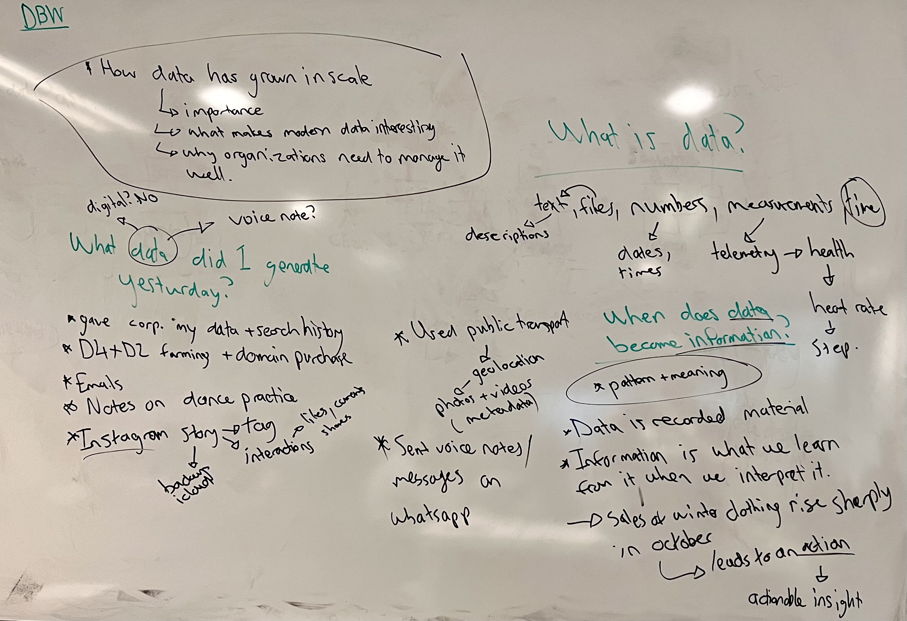

> Data takes many forms, and digital systems let us collect, copy, combine and analyse it at scale.

[Back to contents](#contents)

## 2. The story of data

How did we get here? The history of data can be split into five eras. Each one changed how much data could be collected, and what it took to manage it.

### 2.1 Records and paper archives

Data is much older than computers. Businesses, governments and institutions have always collected it, written by hand into ledgers, registers, maps, surveys and reports. The ledger below records a cotton company's accounts in the 1890s, one handwritten line at a time.

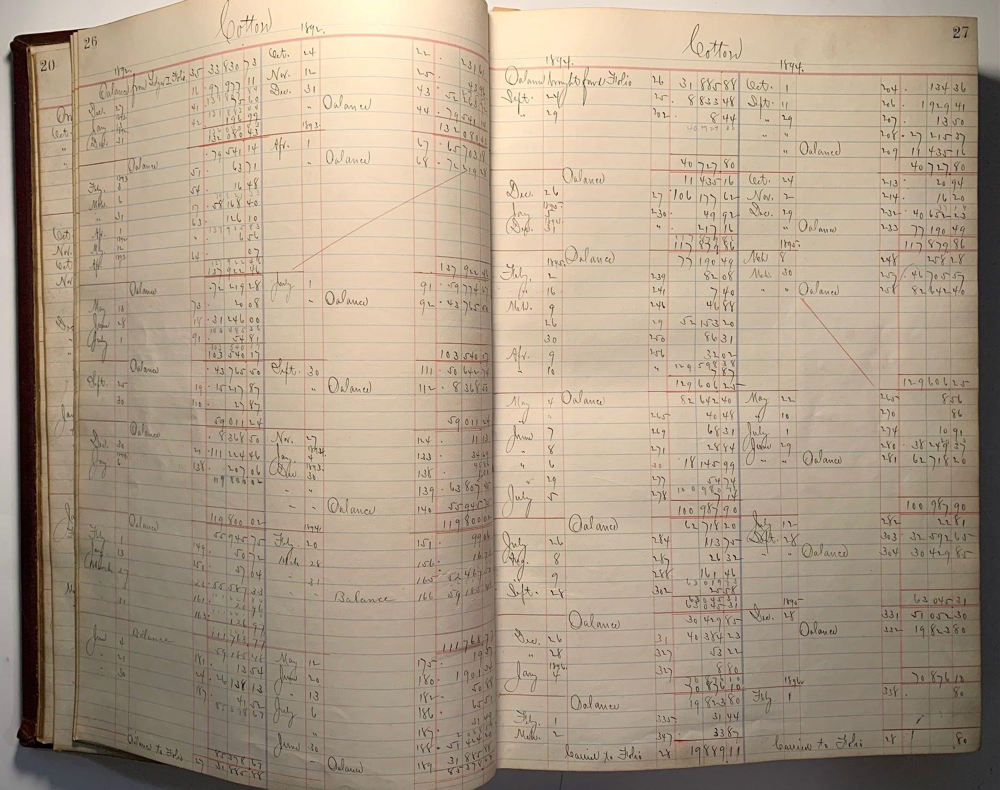

Collecting the data was the easy part. Working with it was slow. Finding one entry meant searching through the pages by hand, comparing two months meant copying numbers from one page to another, and every update had to be written in by someone. The books also had to be kept safe, because there was no backup.

All of that put a ceiling on **volume** *[how much data there is]*. An organisation could only keep as much data as it had people to manage and rooms to store it in.

### 2.2 Computers and databases

Computers could process records far faster than any clerk, so organisations started moving the records they already kept onto them. Payroll, inventory, bank transactions and customer information were all digitised. The customer records eventually grew into **CRM** systems *[customer relationship management: software that holds everything a company knows about its customers]*.

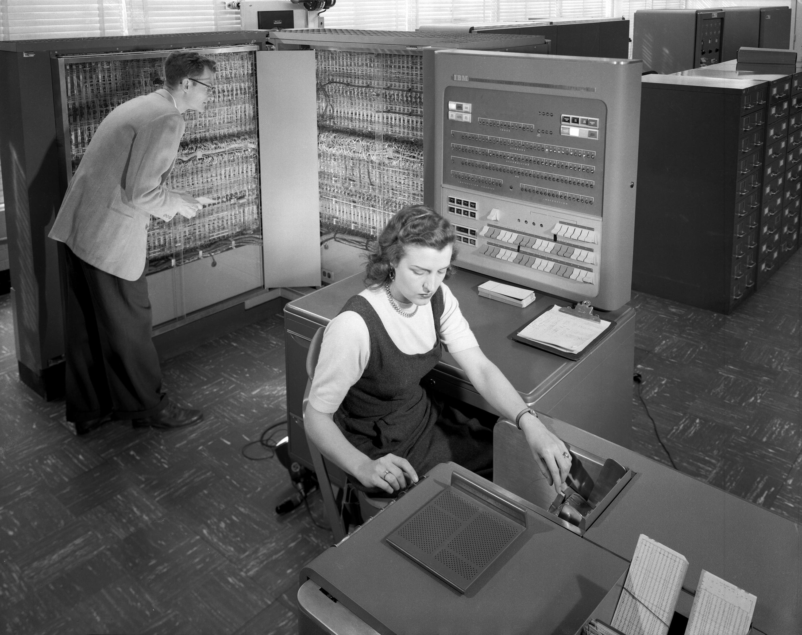

Storing records on a computer was only half of it. **Relational databases** gave those records a structure, and **SQL** gave people a way to ask questions of them. Recall that a query describes *what* you want, and the database works out how to fetch it. The same query can be run again next month on new data and answer the same way, so organisations could process their data repeatedly and consistently instead of redoing the work by hand.

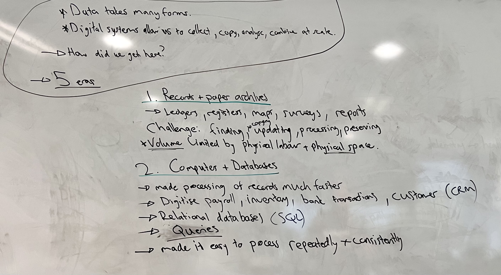

### 2.3 The internet and the World Wide Web

Until now, data mostly stayed inside the organisation that collected it. Networked computers changed that, because they made it easy to exchange information between them. The internet grew out of earlier networks such as **ARPANET** *[one of the first computer networks, built in the United States in the late 1960s]*.

The **World Wide Web** came later, and it was built at CERN, the European physics laboratory near Geneva. CERN's experiments generated a lot of data, and scientists from universities around the world travelled there to plug into its computers and run their experiments. Tim Berners-Lee proposed the Web in 1989 to meet "the demand for automated information-sharing between scientists in universities and institutes around the world" ([A short history of the Web](https://home.cern/science/computing/the-birth-of-the-web/short-history-web/)).

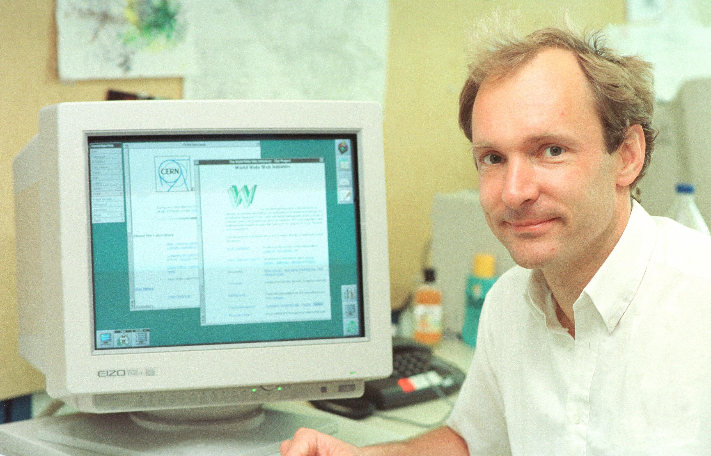

The first web server was a NeXT computer in Berners-Lee's office, with a handwritten label telling people not to switch it off.

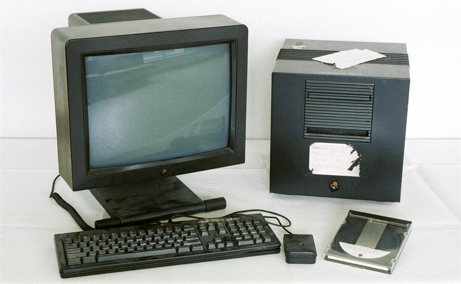

The Web didn't replace the internet. It's one service that runs on top of it. In late 1993, the Web was only 1% of internet traffic, and the rest was email, file transfer and remote access.

What made the Web work was **HTML** and the **hyperlink** *[a link from one page to another, written in HTML as `<a href="...">`]*. Any page could point to any other, on any server. On 30 April 1993, CERN made the Web's software free for anyone to use, which helped it spread.

Public websites and e-commerce followed, and search engines to find your way around them. The rush of investment in internet companies peaked around 2000 in the **dot-com bubble** *[a few years when investors poured money into internet companies, many of which then collapsed]*. Every website, online shop and search engine was a new kind of digital activity, and each one produced data of its own, so the volume being collected went up again.

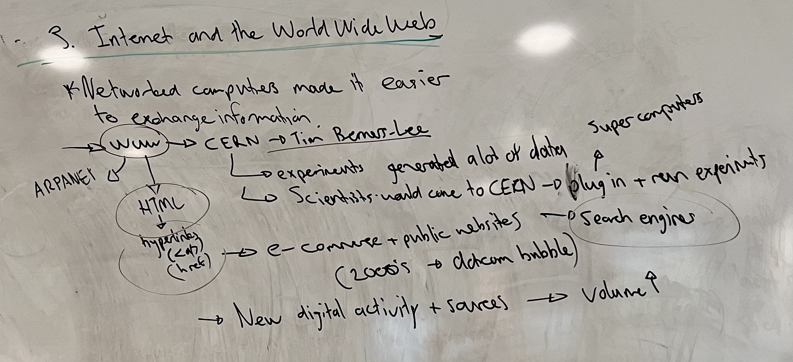

### 2.4 Smartphones, social media and connected devices

On a computer, you went online when you sat down at it. A smartphone is online all day, in your pocket, so with smartphones and social media people started creating content and interacting with it continuously. Platforms recorded every **event** *[one recorded thing that happened, with a time attached]*:

- **Clickstreams** *[the record of every click a user makes as they move through a site or app]*
- Searches
- Uploads
- Views and interactions
- Purchases

People weren't the only source any more. Sensors added streams of data of their own, like the fitness watch from section 1.2. Cars, doorbells and thermostats send measurements back too, and together these devices are called the **Internet of Things**, or **IoT** *[everyday physical devices connected to the internet that collect and send data]*.

This changed what data looked like, not just how much of it there was. It was no longer limited to business records that someone had typed in carefully, row by row. Much of it was now **unstructured** *[data with no fixed rows and columns, such as video, audio, images and free text]*.

YouTube shows how many forms one platform deals with. A single video is the video itself, in several qualities, plus its audio, a transcript, and closed captions. Around it sit the subscribes, likes and comments, the edits made in YouTube Studio, and the thumbnail.

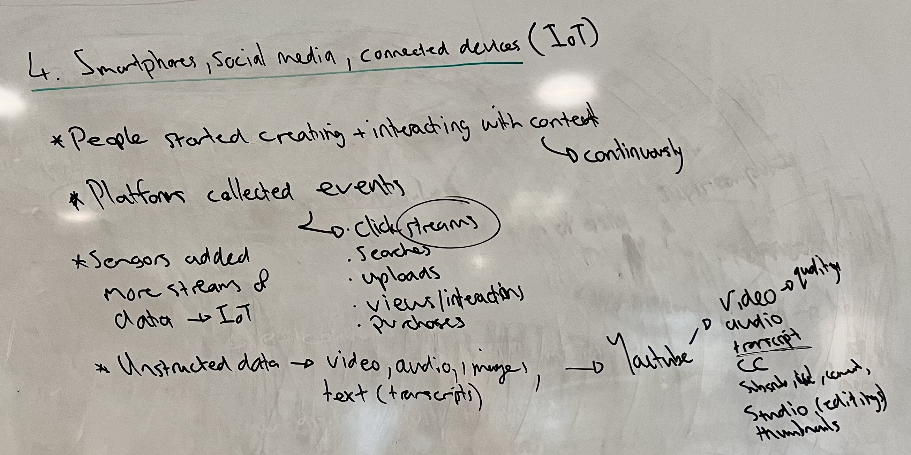

### 2.5 Big data, cloud computing and AI

The fifth era is the one we're in now. It's the combination of large datasets, diverse formats and demanding **analytical workloads** *[jobs that read through large amounts of data to answer a question, rather than handling one record at a time]*.

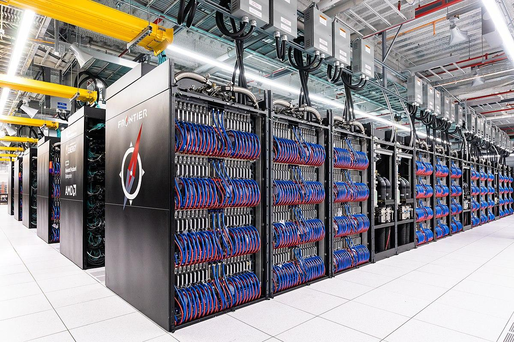

One computer can't keep up with that, so the work is spread across many. **Distributed processing** splits one large job across many machines that work on it at the same time.

The idea that made this practical came from Google, in a 2004 paper describing **MapReduce** ([Dean and Ghemawat, 2004](https://research.google/pubs/mapreduce-simplified-data-processing-on-large-clusters/)). Recall `.map()`, `.filter()` and `.reduce()` on a JavaScript array: map changes each item, and reduce combines all the items into one result. MapReduce applies the same two steps to a dataset too big for one machine:

1. The dataset is split into chunks.
2. Each chunk is sent to a different machine, which runs the map step on it. All the chunks are processed at the same time.
3. The results are combined back together in the reduce step.

Tools grew up to do this for you. **Apache Hadoop** is the older one: a framework "that allows for the distributed processing of large data sets across clusters of computers using simple programming models" ([Apache Hadoop](https://hadoop.apache.org/)). **Apache Spark** is the newer one, "a multi-language engine for executing data engineering, data science, and machine learning on single-node machines or clusters" ([Apache Spark](https://spark.apache.org/)).

Building and running these systems became a field of its own, **data engineering** *[the work of building the systems that collect, move and prepare data so it can be used]*. A large part of that work is **ETL pipelines** *[extract, transform, load: processes that pull data out of one system, clean and reshape it, and load it into another]*.

CERN, where the Web started, has had to solve all of these problems at once. Up to about a billion particle collisions can happen every second inside the detectors of its particle accelerator, the **Large Hadron Collider** (LHC) ([Storage](https://home.cern/science/computing/storage/)).

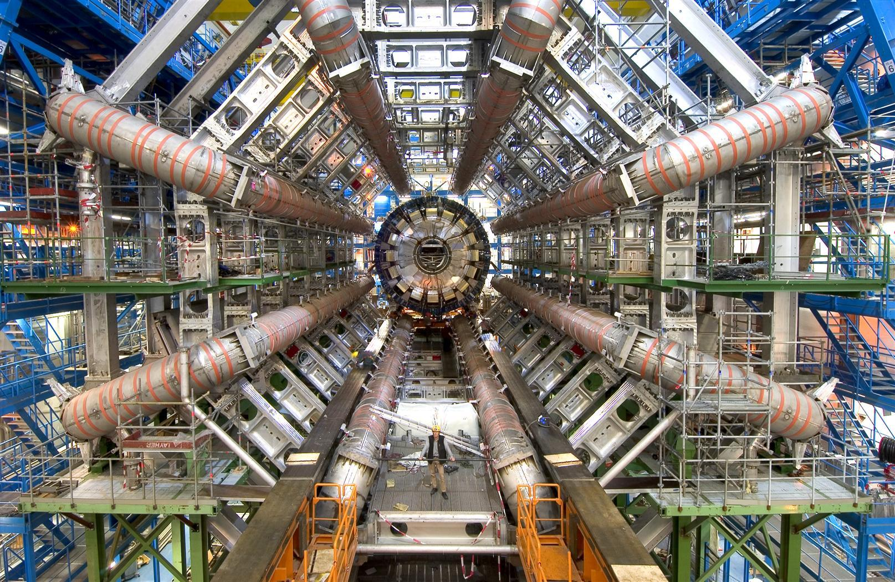

It isn't possible to record all of them. So CERN had to decide what to keep, and you can't fix that decision later: anything not recorded is gone. A **trigger** system filters the collisions as they happen and keeps only the ones that look interesting for further analysis ([Storage](https://home.cern/science/computing/storage/)).

What's kept still has to be stored, and physicists around the world need to analyse it. They no longer travel to CERN to use its computers. The **Worldwide LHC Computing Grid** sends the data out to them instead. It spans over 170 sites in 42 countries, all working on the same data ([Worldwide LHC Computing Grid](https://home.cern/science/computing/grid)).

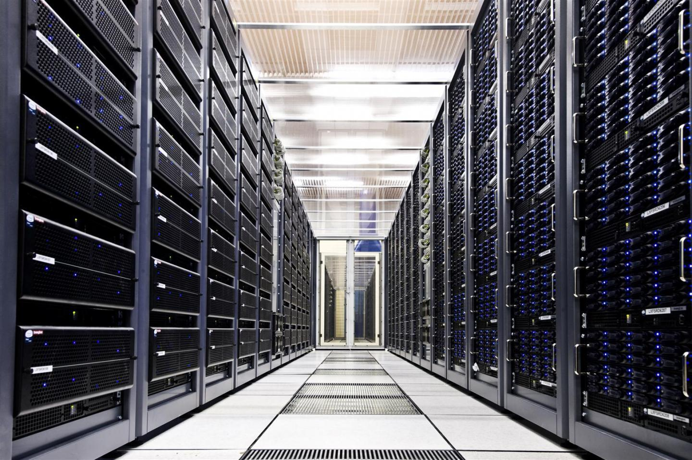

Training **AI models** depends on the same kind of infrastructure. They're trained on very large datasets, which lets them recognise patterns, make predictions and generate content.

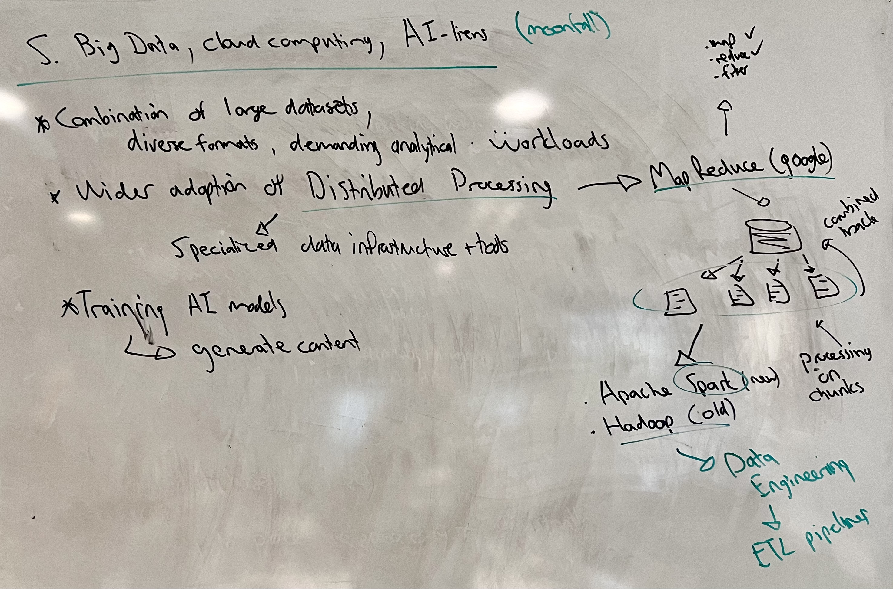

[Back to contents](#contents)

## 3. What big data is

Across the five eras, the same thing kept happening: the data outgrew the tools that had been managing it, and new tools had to be built. **Big data** is the name for that situation today. It describes datasets and data processing challenges whose scale, speed, diversity, or other characteristics make them difficult to manage effectively with conventional approaches alone.

There's no threshold where data becomes big. Something challenging for one business is fine for another. A business with terabytes of transactions, such as one row per sale, can handle them with a conventional analytical database. But add clickstreams, live inventory updates, customer interactions and sensor readings from thousands of stores, and the same business has a big data problem.

So it isn't only about how much data there is. It's also about how the different sources fit together, how reliable the data is, and what the organisation wants to do with it. The five Vs are a framework for describing those things.

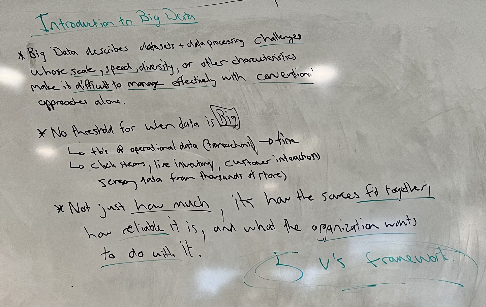

[Back to contents](#contents)

## 4. The five Vs

### 4.1 Volume

**Volume** asks how much data there is. When you quote a number, be clear which amount it is, because the data generated, the data collected and the data stored can be very different numbers. A platform might record every click its users make, but only keep a daily summary of them. The data it generates is then far larger than the data it stores.

### 4.2 Velocity

**Velocity** asks how fast the data arrives. It covers the rate at which data is generated, **ingested** *[taken in by the system that stores it]* and processed. Some data arrives once a month, some once a day, and some is live.

Systems have different requirements depending on the velocity they need. A payment system has to check each payment for fraud instantly, in **real time** *[as it happens, with no waiting]*, or the fraud has already happened. A monthly sales report is in no rush. It can wait for a scheduled **batch** *[a job that processes a whole set of data in one go, at a set time]*.

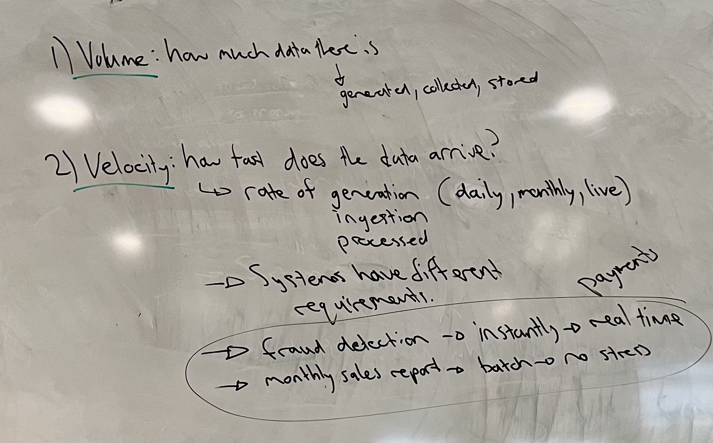

### 4.3 Variety

**Variety** asks what kinds of data exist. Look back at your list from section 1.1: a search is a line of text, a purchase is a row in a table, an Instagram story is an image, and a voice note is audio. Each of those has a different shape, and data comes in three broad shapes:

| Shape | What it looks like | Example |
|---|---|---|
| **Structured** | Fixed rows and columns, every record with the same fields | A table of sales in a relational database |
| **Semi-structured** | Labelled fields, but records don't all have to match | A JSON document in MongoDB |
| **Unstructured** | No fields at all | A video, an audio file, a photo |

It also comes in many formats: `.txt`, `.csv`, `.mp3`, `.jpeg`. The challenge is making sense of information that arrives in different forms, and combining it.

### 4.4 Veracity

**Veracity** asks how reliable the data is. It's about data quality, uncertainty and trustworthiness.

Data can be missing, duplicated, inconsistent, outdated or just wrong. A sensor with a fault records readings that never happened. Two systems store dates in different formats, so the same date doesn't match when you combine them.

More data doesn't mean better conclusions. If the data underneath has a **systemic bias** *[an error built into how the data was collected, so it leans the same way every time]*, adding more of it only repeats the bias.

**Survivorship bias** is a famous example from the Second World War. Analysts studied the bullet holes on bombers that came back from missions, to decide where to add armour. The statistician Abraham Wald pointed out that they were only looking at the planes that survived. The places with no holes were where the planes that didn't come back had been hit, so that's where the armour belonged.

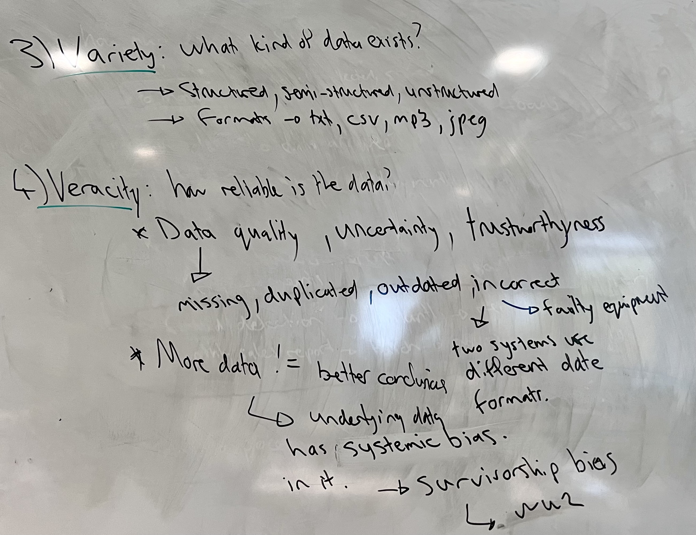

### 4.5 Value

**Value** asks what you can get from the data. It's the useful outcomes data makes possible: better decisions, predicting when equipment will fail, understanding customer behaviour, detecting fraud, or making a service more efficient.

Value brings the discussion back to purpose. If a company collects petabytes of data but can't explain how it helps anyone make a decision, why is it collecting it at all?

### 4.6 A framework, not a checklist

The five Vs are a way of describing the challenges a dataset brings. They aren't a checklist that every dataset has to tick, and most examples show some Vs much more strongly than others.

| Example | The Vs it shows most |
|---|---|
| A video platform | Volume and variety |
| Live payments | Velocity and value |
| A poorly maintained customer database | Veracity |

The poorly maintained database might not be big at all. It still has a veracity problem.

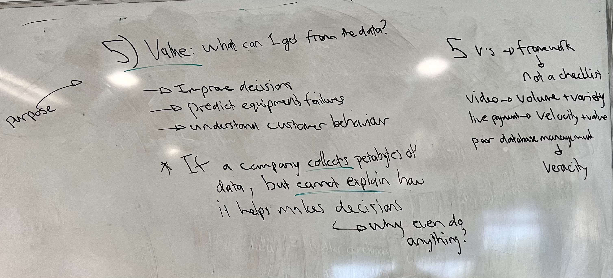

> The five Vs describe what makes a dataset hard to manage, not whether it's big enough to count.

[Back to contents](#contents)

## 5. Why any of this matters

If an organisation has all this data, how does it actually use it?

Take a retail business. It has transaction records, customer information, website activity and inventory data, each in a different system and each describing a different part of the business. What the business wants to understand cuts across all of them: sales trends, customer behaviour, and how products are performing.

That's where data warehousing comes in. A **data warehouse** *[a database built to bring data from many systems together for analysis and reporting]* organises and combines data from different systems into one consistent place to analyse it. That's what the rest of this course builds.

[Back to contents](#contents)

## 6. Sources

1. CERN, [A short history of the Web](https://home.cern/science/computing/the-birth-of-the-web/short-history-web/)
2. CERN, [Storage](https://home.cern/science/computing/storage/)
3. CERN, [Worldwide LHC Computing Grid](https://home.cern/science/computing/grid)
4. Dean, J. and Ghemawat, S., [MapReduce: Simplified Data Processing on Large Clusters](https://research.google/pubs/mapreduce-simplified-data-processing-on-large-clusters/), Google, 2004
5. Apache Software Foundation, [Apache Hadoop](https://hadoop.apache.org/)
6. Apache Software Foundation, [Apache Spark](https://spark.apache.org/)

[Back to contents](#contents)
