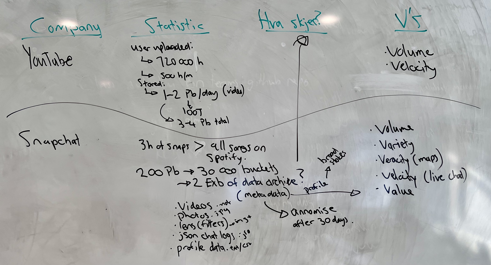
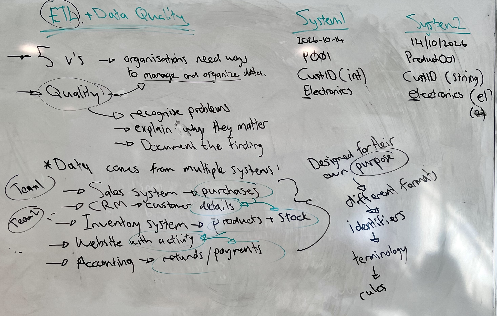
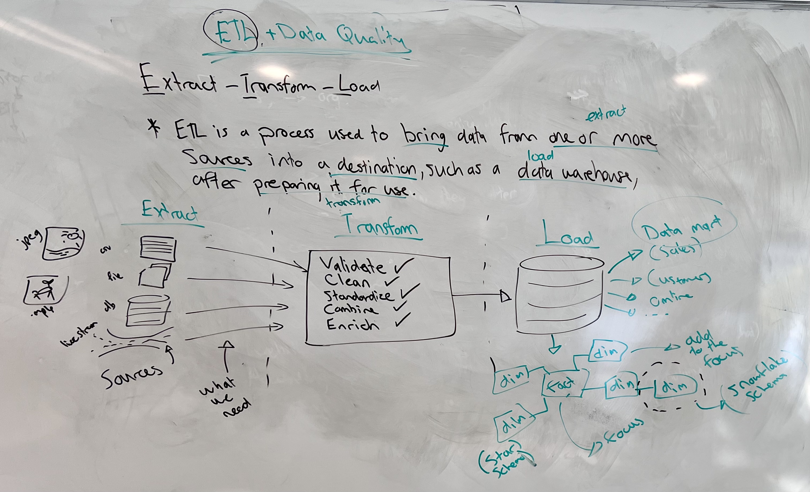
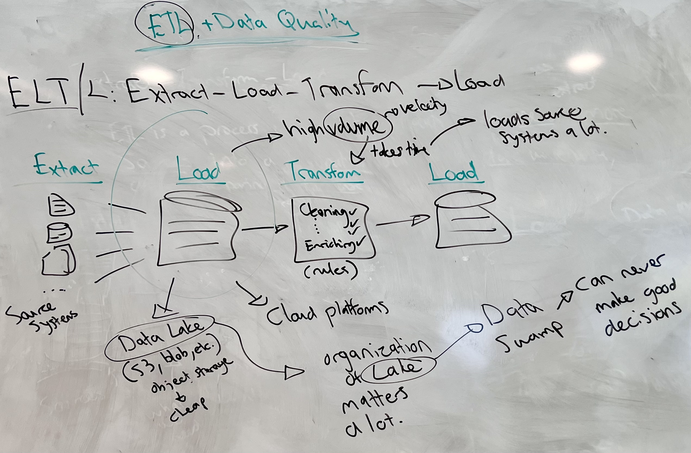
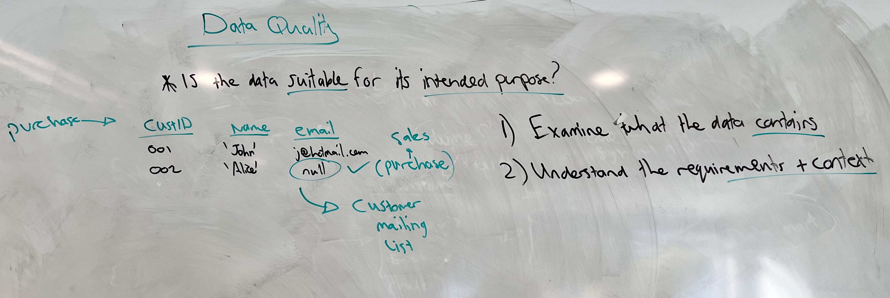
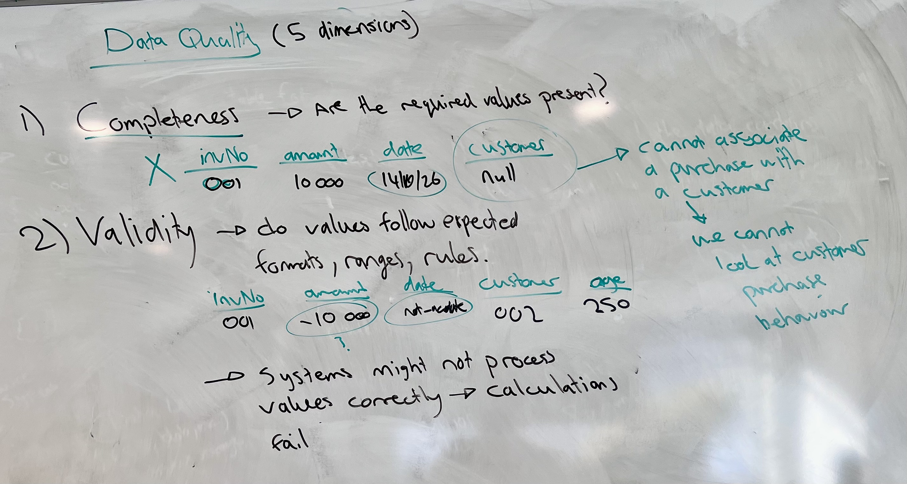
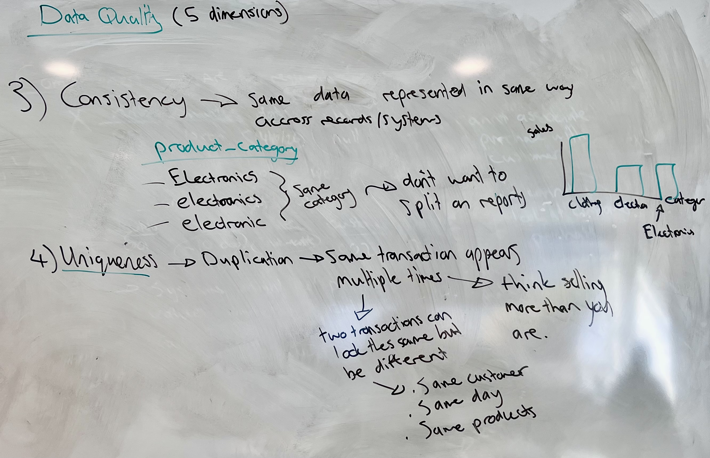
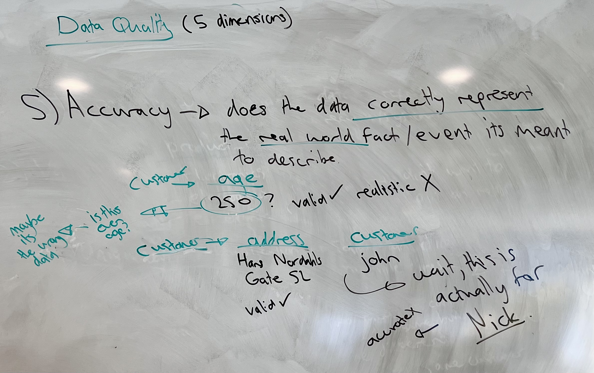

# ETL and Data Quality

> In this lesson you will learn how organisations bring data from many source systems together using ETL, and how ELT and the data lake change that process. You will then use the dimensions of data quality to judge whether data is fit for its intended purpose. New terms get a plain-English version in brackets.

**By the end of this lesson you should be able to:**

1. **Explain** why data from several source systems can't be combined into a reliable report as it is.
2. **Describe** the three stages of ETL.
3. **Describe** the purpose of a data mart.
4. **Explain** the difference between a star schema and a snowflake schema.
5. **Contrast** ETL with ELT.
6. **Describe** the role of a data lake in ELT.
7. **Describe** the six dimensions of data quality.
8. **Classify** a data quality problem by the dimension it falls under.

## Contents

1. [What the numbers have in common](#1-what-the-numbers-have-in-common)
   - [1.1 How much data everyday apps handle](#11-how-much-data-everyday-apps-handle)
   - [1.2 What happens to it all?](#12-what-happens-to-it-all)
2. [Data comes from many systems](#2-data-comes-from-many-systems)
   - [2.1 One business, five systems](#21-one-business-five-systems)
   - [2.2 The same thing, recorded differently](#22-the-same-thing-recorded-differently)
3. [ETL: Extract, Transform, Load](#3-etl-extract-transform-load)
   - [3.1 Extract](#31-extract)
   - [3.2 Transform](#32-transform)
   - [3.3 Load](#33-load)
   - [3.4 What ETL can't do for you](#34-what-etl-cant-do-for-you)
   - [3.5 Data marts and schemas](#35-data-marts-and-schemas)
4. [ELT and the data lake](#4-elt-and-the-data-lake)
   - [4.1 Why load before transforming](#41-why-load-before-transforming)
   - [4.2 The data lake](#42-the-data-lake)
   - [4.3 When the lake becomes a swamp](#43-when-the-lake-becomes-a-swamp)
   - [4.4 ETL and ELT side by side](#44-etl-and-elt-side-by-side)
5. [Data quality](#5-data-quality)
   - [5.1 Suitable for what?](#51-suitable-for-what)
   - [5.2 The six dimensions](#52-the-six-dimensions)
6. [The dimensions in detail](#6-the-dimensions-in-detail)
   - [6.1 Completeness](#61-completeness)
   - [6.2 Validity](#62-validity)
   - [6.3 Consistency](#63-consistency)
   - [6.4 Uniqueness](#64-uniqueness)
   - [6.5 Accuracy](#65-accuracy)
   - [6.6 Timeliness](#66-timeliness)
   - [6.7 Recording what you find](#67-recording-what-you-find)
7. [Sources](#7-sources)

## 1. What the numbers have in common

### 1.1 How much data everyday apps handle

The apps you use every day handle enormous amounts of data. The table below collects some of the figures published about three of them. The **Source** column shows where each figure comes from. Popular statistics often get passed from site to site without a date or a link, so it's worth following them back to the original where you can. The ones marked *not traced* haven't been followed back to the company or a report yet.

| Company | Statistic | Source | Vs |
|---|---|---|---|
| YouTube | More than 500 hours of video uploaded every minute, which works out to about 720,000 hours a day | YouTube, 2019 ([Tubefilter](https://www.tubefilter.com/2019/05/07/number-hours-video-uploaded-to-youtube-per-minute/)) | Volume, velocity |
| YouTube | 1-2 PB *[petabytes: one petabyte is a million gigabytes]* of new video stored per day | Not traced | Volume |
| Snapchat | More than 2 EB *[exabytes: one exabyte is a thousand petabytes]* of data, about 1.5 trillion photos and videos, moved between cloud providers in 2022 | AWS case study ([Snap](https://aws.amazon.com/solutions/case-studies/snap-case-study/)) | Volume |
| Snapchat | Three hours of snaps is more data than every song on Spotify | Not traced | Volume, velocity |
| Netflix | 700 billion events a day through its data pipeline | Netflix engineering talk, 2016 ([InfoQ](https://www.infoq.com/presentations/netflix-keystone)) | Volume, velocity |

Look at the first two YouTube rows. One counts hours of video **uploaded**, the other counts petabytes **stored**. Those are different measurements of different things, so when you read a statistic like this, check whether it's about data being generated, sent or stored. YouTube keeps several qualities of every video, so the amount it stores is not the same as the amount people upload.

Snapchat shows more than volume. A single account produces many kinds of file:

- Videos, as `.mov` files.
- Photos, as `.jpg` files.
- Lenses *[Snapchat's filters]*, which are images plus the data that drives them.
- Chat logs, as JSON.
- Profile data, as text or CSV.

That's **variety**. Live chat has to be delivered as it happens, which is **velocity**. Locations on Snap Map can be off, which is **veracity**.

The **value** comes from the **metadata** *[data about the data: when, where and on what device a snap was sent]*. Put enough of it together and it describes a person in broad strokes, which is what a profile for advertising is built from. Snapchat is also said to **anonymise** *[remove anything that ties data back to a specific person]* this metadata after 30 days, though that's another figure that hasn't been traced.

[Back to contents](#contents)

### 1.2 What happens to it all?

Every number in that table describes data arriving. None of them say what happens to it afterwards.

So what happens to it? Snapchat's metadata only becomes a profile because something collects it from different places, puts it together and makes sense of it. The five Vs describe why that's hard: there's a lot of data, it arrives quickly, it comes in many forms, and some of it is wrong. What they tell you is that organisations need ways to manage and organise their data before they can get any value from it.

Two of those ways are ETL and data quality. 

> **ETL** is the process that moves data from where it's created into somewhere it can be analysed. 

> **Data quality** is how you decide whether that data can be trusted once it gets there.

[Back to contents](#contents)

## 2. Data comes from many systems

### 2.1 One business, five systems

Take a business that sells products both in shops and online. It doesn't keep all its data in one place. It might have:

- A **sales system**, which records purchases.
- A **CRM** *[customer relationship management: software that holds what the business knows about its customers]*, which stores customer details.
- An **inventory system**, which tracks products and stock.
- A **website**, which records what people do online.
- An **accounting system**, which records payments and refunds.

Different teams often own different systems. The sales team runs one and the warehouse team runs another, and none of them were built with the others in mind.

The data in them is still connected. Follow one sale and it passes through every system:

&emsp;It might start as a visit to the **website**,\
&emsp;&emsp;&emsp;which turns into a purchase in the **sales system**,\
&emsp;&emsp;&emsp;&emsp;&emsp;made by a customer stored in the **CRM**,\
&emsp;&emsp;&emsp;&emsp;&emsp;&emsp;&emsp;for a product tracked in the **inventory system**,\
&emsp;&emsp;&emsp;&emsp;&emsp;&emsp;&emsp;&emsp;&emsp;and it ends up as a payment in **accounting**.

The questions a business wants answered, like which products sell best online or which customers come back, cut across several systems at once.

### 2.2 The same thing, recorded differently

Each of those systems was designed for its own purpose. So each one may use different:

- **Formats**, such as how a date is written.
- **Identifiers** *[the value a system uses to tell one record apart from another, like a product code]*.
- **Terminology**, the words used for the same thing.
- **Rules**, such as which fields are required.

Here is the same sale recorded by two systems:

| | System 1 | System 2 |
|---|---|---|
| Date | `2026-10-14` | `14/10/2026` |
| Product | `P001` | `Product001` |
| Customer ID | stored as a number | stored as text |
| Category | `Electronics` | `electronics` |

A person reading both rows can see they describe the same thing. A computer combining them can't. It sees two different date formats, two different product codes, two customer IDs of different types that won't match when you join on them, and two category names that differ by one capital letter.

So if an organisation collects all this data, can it immediately combine it and produce a reliable report? No. Before anything is done to it, the combined data is likely to be:

- **Incomplete**, with values missing in one system that exist in another.
- **Inconsistent**, like the two rows above.
- **Duplicated**, with the same customer or sale recorded in more than one system.
- **Outdated**, because a customer changed their address in one system and not the other.
- **Interpreted differently**, because two systems use the same word to mean different things.

Working with data from several systems means being able to recognise these problems, explain why they matter, and document what you find.

[Back to contents](#contents)

## 3. ETL: Extract, Transform, Load

**ETL** stands for **Extract, Transform, Load**. It is a process used to bring data from one or more sources into a destination, such as a data warehouse, after preparing it for use.

Each part of that sentence is one of the three stages. 

*Bring data from one or more sources* is **extracting**. 

*Preparing it for use* is **transforming**. 

*Into a destination* is **loading**. 

Microsoft describes ETL as "a data integration process that consolidates data from diverse sources into a unified data store", where the data "is modified according to business rules" ([Extract, transform, load (ETL)](https://learn.microsoft.com/en-us/azure/architecture/data-guide/relational-data/etl)).

### 3.1 Extract

**Extracting** means retrieving data from the **source systems** *[the systems where the data is created and used day to day, like the sales system, CRM and inventory system]*. Those sources can be databases, spreadsheets, business applications or files, in any format: CSV files, images, video like YouTube's, and even live streams.

You don't extract everything. You take the data that's relevant to what you need. If the goal is a report on sales, the website's record of which pages people scrolled past might not be part of it.

### 3.2 Transform

**Transforming** means preparing the extracted data so it's consistent and suitable for its intended use. It's where the mismatched dates, product codes and category names between systems get dealt with, and it usually involves some of these:

- **Validate**: check that values follow the rules they should, such as a date actually being a date.
- **Clean**: fix or remove values that are wrong, and decide how duplicates are handled.
- **Standardise**: pick one format and convert everything to it. Every date becomes `2026-10-14`, every product code becomes `P001`, and every category starts with a capital letter.
- **Combine**: join records from different systems, so a sale from the sales system is matched with the customer from the CRM.
- **Enrich**: add something that wasn't there, such as calculating a new field like the total value of an order from its quantity and price.

The transform step runs on **rules** *[decisions written down in advance about how each kind of value should be handled]*. "Convert every date to year-month-day" is a rule, and so is "treat `electronics` and `Electronics` as the same category".

### 3.3 Load

**Loading** means putting the prepared data into its destination. A **data warehouse** *[a database built to bring data from many systems together for analysis and reporting]* is the usual example. Once it's there, it can be queried and used for reporting and analysis.

This is where the work pays off. Comparing sales in physical shops against sales online was impossible while the two sets of data used different dates, product codes and category names. After transforming, both sets look the same, so one query can compare them.

### 3.4 What ETL can't do for you

Data doesn't simply move from one place to another. It may also need to be changed so it can be combined and used in a meaningful way, and that's what the transform step is for.

But transforming can only fix the problems you know about. Not every problem can be resolved safely without understanding what the data means. A rule that merges `Electronics` and `electronics` is easy to write, because you can see they're the same category. A rule for a refund recorded as a negative amount needs someone to know whether negative amounts are refunds or mistakes.

So ETL doesn't guarantee good data. A transform built on the wrong rules produces wrong data in a neat format. A problem nobody noticed goes through untouched. That's why checking the quality of the data comes before the rules get written.

### 3.5 Data marts and schemas

A warehouse holds data for the whole organisation, but most people only need part of it. A **data mart** *[a smaller, focused section of a warehouse built for one area of the business]* serves one area: a sales mart for the sales team, a customer mart for marketing, an online mart for the web team.

Inside a warehouse or a mart, tables are commonly arranged in a **star schema**. Microsoft describes it as an approach that "requires modelers to classify their model tables as either *dimension* or *fact*" ([Understand star schema](https://learn.microsoft.com/en-us/power-bi/guidance/star-schema)).

- A **fact table** is the focus. It stores observations or events, such as sales orders, and the numbers you want to add up, such as amounts.
- **Dimension tables** sit around it and add to that focus. They describe the things involved in each event: the product, the customer, the shop, the date. You use them to filter and group the facts.

Drawn out, the fact table sits in the middle with the dimensions around it, which is where the star comes from. When a dimension is split into further tables, such as a product table linked to a subcategory table linked to a category table, the branches spread outwards and the design is called a **snowflake schema**.

Both schemas come back later in the course.

[Back to contents](#contents)

## 4. ELT and the data lake

### 4.1 Why load before transforming

**ELT** stands for **Extract, Load, Transform**. The same three steps happen, in a different order: the data is loaded first and transformed afterwards. In practice it's often Extract, Load, Transform and then Load again, because the transformed data still has to end up in the warehouse.

The reason for changing the order is volume, and often velocity with it. Transforming a large amount of data takes time. In ETL, the data is pulled from the source systems as part of the transform, so for all that time the pipeline is reading from systems the business is using to make sales and serve customers. That puts a lot of load on the source systems, and doing it straight from the source every time is expensive.

ELT gets the data out of the source systems quickly, in its original state, and puts it somewhere cheap. The transforming happens from there, as slowly as it needs to, without touching the source systems again. Microsoft notes that "typical use cases for ELT fall within the big data realm" ([Extract, transform, load (ETL)](https://learn.microsoft.com/en-us/azure/architecture/data-guide/relational-data/etl)), which is the volume problem again.

### 4.2 The data lake

The cheap place the raw data goes is usually a **data lake**. Microsoft defines it as "a storage repository that holds large volumes of data in its native, raw format" ([What is a data lake?](https://learn.microsoft.com/en-us/azure/architecture/data-guide/scenarios/data-lake)).

A data lake is normally built on **object storage** *[storage that keeps whole files as objects, rather than rows in a table]*, such as Azure Blob Storage or Amazon S3. Azure also offers **Azure Data Lake Storage**, which is Blob Storage with extra features for analytics. Object storage is cheap per gigabyte, which matters when you're keeping everything. It also doesn't care what's in a file, so the CSV exports, JSON chat logs and video files can all go in as they are.

That's the difference from a warehouse. A warehouse expects data that's already been shaped to fit its tables. A data lake takes data before it's shaped, and the shaping happens later.

This is why ELT is common on cloud platforms. AWS calls ELT "the standard choice for modern analytics" ([The difference between ETL and ELT](https://aws.amazon.com/compare/the-difference-between-etl-and-elt/)), and the cloud providers sell exactly the cheap bulk storage it depends on. Because most organisations now deal with data at a volume and velocity that ETL struggles with, the lake has become a **staging area** *[a holding place for data on its way somewhere else]* between the source systems and the warehouse.

### 4.3 When the lake becomes a swamp

Raw doesn't mean disorganised. The data in a lake hasn't been transformed yet, but somebody still needs to know what each file is, where it came from, and when it arrived. How the lake is organised matters a lot.

A lake where data is dumped with no record of what it contains turns into a **data swamp**. AWS puts it this way: without ways to catalogue and secure it, "data cannot be found, or trusted resulting in a 'data swamp'" ([What is a data lake?](https://aws.amazon.com/what-is/data-lake/)).

A swamp defeats the purpose of having the data. If nobody can find the right file, or nobody can tell whether a file is this week's export or last year's, then any report built from it is a guess, and the organisation can never make good decisions from it.

### 4.4 ETL and ELT side by side

| | ETL | ELT |
|---|---|---|
| Order | Extract, transform, load | Extract, load, transform, then load into the warehouse |
| Where raw data waits | Nowhere; it's transformed on the way | In a data lake, in its original state |
| Load on source systems | Higher, because they're read while transforming | Lower, because they're read once and left alone |
| Suits | Smaller volumes, data with a known, fixed format | High volume and velocity, many formats, cloud platforms |

> ETL transforms on the way in. ELT stores first and transforms from the copy.

[Back to contents](#contents)

## 5. Data quality

### 5.1 Suitable for what?

ETL is only as good as the rules its transform step follows. Writing good rules means knowing what's wrong with the data, and that's what **data quality** is about. The question it asks is:

> Is the data suitable for its intended purpose?

The important word is *purpose*. Here are two customers from a purchase record:

| CustID | Name | Email |
|---|---|---|
| 001 | John | j@hotmail.com |
| 002 | Alice | *null* |

Is the missing email a problem? For a sales warehouse that records purchases, no. Alice bought something, and you know who she is and what she paid. The row is fine.

Now use the same data to build a customer mailing list. Alice's row is useless for that, because there's nothing to send to, so it would be excluded. The data didn't change. The purpose did.

So data quality isn't a fixed property of a dataset. You can't judge it until you know what it's for, which gives you two steps:

1. **Examine what the data contains.** Look at the values that are actually there, not the ones you expect to be there.
2. **Understand the requirements and the context.** Find out what the data will be used for, and what that use needs from it.

That makes data quality work a matter of exploration and curiosity. When something looks odd, the first question is what it means, not how to delete it.

### 5.2 The six dimensions

To examine data in a structured way, you check it from several angles, called **dimensions** *[separate questions you ask of the same data, each catching a different kind of problem]*. The most widely used set comes from **DAMA UK**, the UK chapter of the Data Management Association, a professional body for people who work with data. The UK Government adopted the same six in its [Data Quality Framework](https://www.gov.uk/government/publications/the-government-data-quality-framework/the-government-data-quality-framework), which describes data quality as "fitness for purpose".

| # | Dimension | The question it asks |
|---|---|---|
| 1 | **Completeness** | Are the required values present? |
| 2 | **Validity** | Do the values follow the expected formats, ranges and rules? |
| 3 | **Consistency** | Is the same data represented in the same way across records and systems? |
| 4 | **Uniqueness** | Does each thing appear only once? |
| 5 | **Accuracy** | Does the data correctly represent the real-world fact or event it describes? |
| 6 | **Timeliness** | Is the data up to date, and available when it's needed? |

The framework adds that "this is not a prescriptive list and may vary depending upon your data and your users' needs". Treat the six as a starting point for your questions, not a checklist every dataset has to pass.

[Back to contents](#contents)

## 6. The dimensions in detail

### 6.1 Completeness

**Completeness** asks whether the required values are present.

| invNo | amount | date | customer |
|---|---|---|---|
| 001 | 10 000 | 14/10/26 | *null* |

This invoice has an amount and a date, but no customer. You can't associate the purchase with anyone, so it can't be part of any analysis of customer purchase behaviour. If the question is how much was sold on 14 October, it still counts.

The word *required* connects back to purpose. Whether a value is required depends on what the data is for, the same as Alice's email.

### 6.2 Validity

**Validity** asks whether values follow the expected formats, ranges and rules.

| invNo | amount | date | customer | age |
|---|---|---|---|---|
| 001 | -10 000 | not-a-date | 002 | 250 |

`not-a-date` in a date column is invalid, and it matters because systems might not process it correctly. Any calculation that uses the date, such as sales per month, either fails or quietly leaves this row out.

The amount of `-10 000` is less clear. It could be a mistake, or it could be a refund. A negative number can be perfectly valid, and the only way to find out is to ask: does the accounting system record refunds as negative amounts? This is where the curiosity comes in. Deleting it because it looks wrong could throw away a real refund.

The age of `250` goes the other way. If the rule for age is "a positive number", 250 passes. It's valid. You could add a range rule that limits age to something realistic, and you probably should, but it's accuracy, further down, that tells you the rule is needed.

### 6.3 Consistency

**Consistency** asks whether the same data is represented in the same way across records and systems.

A `product_category` column containing `Electronics`, `electronics` and `electronic` has three values for one category. Put that column in a sales report and you get a bar for Clothing and three separate bars for electronics, each one shorter than it should be. You don't want one category split across a report. Standardising in the transform step is the fix, once you've spotted it.

### 6.4 Uniqueness

**Uniqueness** asks whether each thing appears only once. Its opposite is **duplication**: the same transaction appearing more than once, perhaps because it came in from two systems. Every duplicate sale makes it look like you're selling more than you are.

But be careful about what you call a duplicate. Two transactions can look the same and be different. The same customer can buy the same products on the same day, twice. Removing one of those as a duplicate would make you look like you're selling less than you are. Deciding which records really are the same is one of the rules the transform step needs, and it's another place to ask before you delete.

### 6.5 Accuracy

**Accuracy** asks whether the data correctly represents the real-world fact or event it's meant to describe.

Go back to the age of 250. It's valid, but it isn't realistic, so it isn't accurate. And once you start asking why it's there, there are other explanations than a typo. Maybe it's the wrong data in the wrong column. Maybe it isn't one customer's age at all, but a total or an average that ended up in the wrong field.

Accuracy can also fail on data that looks perfect. A customer record with the address Hans Nordahls gate 52 and the name John is valid: the address is real and correctly formatted. If that customer is actually Nick, the record is still wrong. No format check or range rule will ever catch that, because nothing about the values breaks a rule.

That's the difference between validity and accuracy. Validity checks whether a value *could* be right. Accuracy checks whether it *is* right.

> A value can pass every rule and still be wrong.

### 6.6 Timeliness

**Timeliness** asks whether the data is up to date and available when it's needed. The Government framework describes it as "the degree to which the data is an accurate reflection of the period that they represent, and that the data and its values are up to date".

Outdated data, one of the problems you get when combining systems, belongs here. A customer moves house and updates their address in the CRM, but the sales system still has the old one. Neither value breaks a rule, and the old address was accurate when it was recorded. It just isn't any more.

Timing matters too. A sales report read every Monday morning needs the weekend's sales in it. If the shops' systems only send their data on Tuesday, Monday's report is missing two days, even though every row that did arrive is correct.

How up to date the data needs to be depends on the purpose, the same as every other dimension. Recall velocity from the five Vs: a monthly sales report can wait for a batch, but fraud detection on payments needs the data in seconds.

### 6.7 Recording what you find

Spotting a problem is only part of the job. Working with data from several systems means being able to recognise problems, explain why they matter, and document what you find. The dimensions give you the words for all three. For each problem, write down:

- **What** you found, and in which records.
- **Which dimension** it falls under.
- **Why it matters** for the purpose the data is meant to serve.

"Customer is null on invoice 001, a completeness problem, so this invoice can't be included in any customer analysis" is a finding someone else can act on. It's also what the transform rules get written from.

[Back to contents](#contents)

## 7. Sources

1. Tubefilter, [More Than 500 Hours Of Content Are Now Being Uploaded To YouTube Every Minute](https://www.tubefilter.com/2019/05/07/number-hours-video-uploaded-to-youtube-per-minute/), 2019
2. Amazon Web Services, [Snap case study](https://aws.amazon.com/solutions/case-studies/snap-case-study/)
3. Bakas, P., [Netflix Keystone - How We Built a 700B/day Stream Processing Cloud Platform in a Year](https://www.infoq.com/presentations/netflix-keystone), InfoQ, 2016
4. Microsoft Learn, [Extract, transform, load (ETL)](https://learn.microsoft.com/en-us/azure/architecture/data-guide/relational-data/etl), Azure Architecture Center
5. Amazon Web Services, [The difference between ETL and ELT](https://aws.amazon.com/compare/the-difference-between-etl-and-elt/)
6. Microsoft Learn, [What is a data lake?](https://learn.microsoft.com/en-us/azure/architecture/data-guide/scenarios/data-lake), Azure Architecture Center
7. Amazon Web Services, [What is a data lake?](https://aws.amazon.com/what-is/data-lake/)
8. Microsoft Learn, [Understand star schema and the importance for Power BI](https://learn.microsoft.com/en-us/power-bi/guidance/star-schema)
9. Government Data Quality Hub, [The Government Data Quality Framework](https://www.gov.uk/government/publications/the-government-data-quality-framework/the-government-data-quality-framework), 2020
10. DAMA UK Working Group, *The Six Primary Dimensions for Data Quality Assessment*, 2013 (no stable link)

[Back to contents](#contents)
