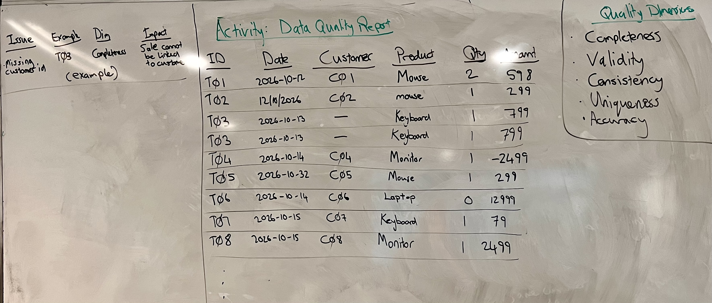
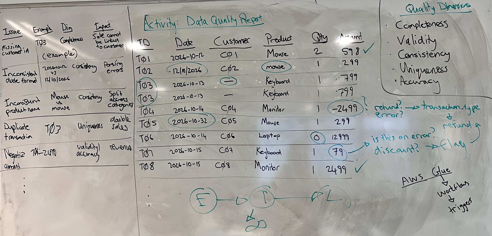
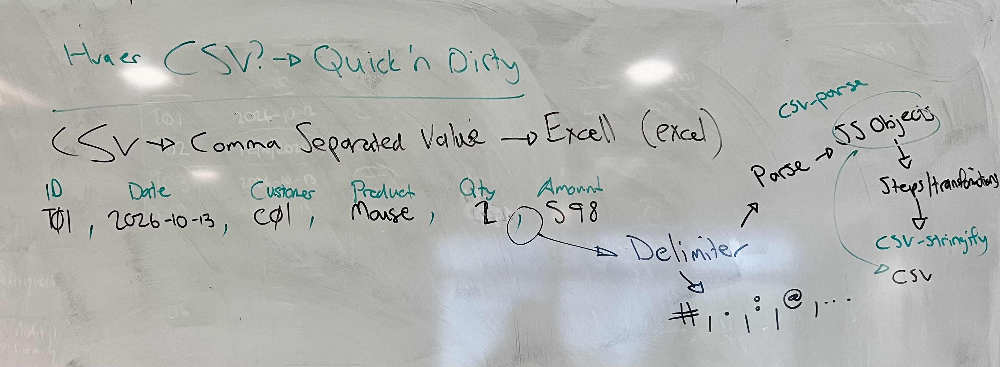

# Data Cleaning and Preprocessing

> In this lesson you will examine a dataset for quality problems and record them in a data quality report.
>
> You will then learn how data cleaning fits into preprocessing and the transform step of ETL, and follow a small Node.js pipeline that turns written cleaning rules into code that reads, cleans and writes a CSV file.
>
> New terms get a plain-English version in brackets.

**By the end of this lesson you should be able to:**

1. **Examine** a dataset for data quality problems.
2. **Describe** the structure of a CSV file.
3. **Explain** how data cleaning fits within preprocessing.
4. **Explain** why a cleaning rule fixes, flags or rejects a record.
5. **Describe** how small pipelines can be chained into a larger workflow.
6. **Outline** how a cleaning pipeline turns documented rules into code that reads, cleans and writes CSV.

## Contents

1. [Reading a dataset for quality problems](#1-reading-a-dataset-for-quality-problems)
   - [1.1 A sales extract](#11-a-sales-extract)
   - [1.2 A data quality report](#12-a-data-quality-report)
2. [CSV](#2-csv)
   - [2.1 What a CSV file is](#21-what-a-csv-file-is)
   - [2.2 From CSV to JavaScript and back](#22-from-csv-to-javascript-and-back)
3. [Preprocessing and cleaning](#3-preprocessing-and-cleaning)
   - [3.1 Preparing data for a use](#31-preparing-data-for-a-use)
   - [3.2 Cleaning is not guessing](#32-cleaning-is-not-guessing)
   - [3.3 Many small pipelines](#33-many-small-pipelines)
4. [Walkthrough: cleaning a month of sales](#4-walkthrough-cleaning-a-month-of-sales)
   - [4.1 From input to output](#41-from-input-to-output)
   - [4.2 What the cleaning report shows](#42-what-the-cleaning-report-shows)
   - [4.3 Setting up the project](#43-setting-up-the-project)
   - [4.4 Writing the rules down](#44-writing-the-rules-down)
   - [4.5 Extract and parse](#45-extract-and-parse)
   - [4.6 The cleaning chain](#46-the-cleaning-chain)
   - [4.7 Load and report](#47-load-and-report)
   - [4.8 What is still in the data](#48-what-is-still-in-the-data)
5. [Sources](#5-sources)

## 1. Reading a dataset for quality problems

### 1.1 A sales extract

Recall the question data quality asks:

> Is the data suitable for its intended purpose?

Here is a short extract from a sales system. The purpose is a sales report: how much was sold, of what, to whom and when.

| ID | Date | Customer | Product | Qty | Amount |
|---|---|---|---|---|---|
| T01 | 2026-10-12 | C01 | Mouse | 2 | 598 |
| T02 | 12/10/2026 | C02 | mouse | 1 | 299 |
| T03 | 2026-10-13 | | Keyboard | 1 | 799 |
| T03 | 2026-10-13 | | Keyboard | 1 | 799 |
| T04 | 2026-10-14 | C04 | Monitor | 1 | -2499 |
| T05 | 2026-10-32 | C05 | Mouse | 1 | 299 |
| T06 | 2026-10-14 | C06 | Laptop | 0 | 12000 |
| T07 | 2026-10-15 | C07 | Keyboard | 1 | 79 |
| T08 | 2026-10-15 | C08 | Monitor | 1 | 2499 |

To answer that question, you look through the rows and identify anything that would stop them serving that purpose. Each problem is written down with:

- what it is
- which row shows it
- which dimension of data quality it falls under
- what it would do to the sales report



[Back to contents](#contents)

### 1.2 A data quality report



Circling the problem values shows where they are. A **data quality report** writes them up as a table: one row per problem, with an example, the dimension, and the impact it could have.

| Issue | Example | Dimension | Potential impact |
|---|---|---|---|
| Inconsistent date formats | `2026-10-12` vs `12/10/2026` | Consistency | Dates misinterpreted or difficult to compare |
| Missing customer ID | T03 | Completeness | Sales cannot be linked to customers |
| Duplicate transaction | T03 appears twice | Uniqueness | Revenue counted twice |
| Inconsistent product naming | `Mouse` vs `mouse` | Consistency | Product totals split across categories |
| Negative amount | T04: `-2499` | Validity / accuracy | Revenue understated if refund handling is wrong |
| Invalid date | T05: `2026-10-32` | Validity | Date processing fails or records are excluded |
| Zero quantity | T06: quantity `0` | Validity / accuracy | Incorrect sales or inventory reporting |
| Suspicious price | T07: keyboard for `79` | Accuracy (potential) | Revenue may be misstated if the price is incorrect |

Only T01 and T08 come through clean.

T03 shows up twice in the report, because one row can break more than one dimension: it has no customer *and* it is duplicated.

Some problems are more certain than others. A date of `2026-10-32` is wrong for certain, because October has 31 days.

A keyboard for 79 is only *suspicious*. The other keyboards cost 799, so it could be a typo, but it could also be a discount. That's why its dimension says *potential*: it's something you can point out, not something you can fix.

> A data quality report is what the cleaning rules get written from.

[Back to contents](#contents)

## 2. CSV

### 2.1 What a CSV file is

A quality report tells you what's wrong with the data. Doing something about it means working with the data in code.

Data exported from business systems very often arrives as a CSV file, because CSV is quick and dirty: almost any system can write one, and almost any tool can read one, including Excel.

**CSV** stands for **comma-separated values**.

Each line in the file is one record, and the values in it are separated by commas. The first line is usually a **header** that names the columns:

```csv
ID,Date,Customer,Product,Qty,Amount
T01,2026-10-13,C01,Mouse,2,598
```

The comma is the **delimiter** *[the character that marks where one value ends and the next begins]*.

It doesn't have to be a comma. Files exist with `;`, `#`, `.`, `:` or `@` as the delimiter, so when you open a CSV from a new system, check what it actually uses.

That variety is what *dirty* means here: there is no formal standard everyone follows. The closest thing is RFC 4180, which says plainly that "there is no formal specification in existence, which allows for a wide variety of interpretations of CSV files" ([RFC 4180](https://www.rfc-editor.org/rfc/rfc4180)).

It describes what most programs do:

- one record per line
- an optional header line
- fields separated by commas
- any field that itself contains a comma, a double quote or a line break wrapped in double quotes

A CSV file is also just text. It has no idea that `598` is a number or that `2026-10-13` is a date.

Every value comes out as a string, and it's up to the program reading it to decide what each column means.

[Back to contents](#contents)

### 2.2 From CSV to JavaScript and back

To clean the rows with JavaScript, you first need them as JavaScript objects. Turning text into a data structure a program can work with is called **parsing**.

The walkthrough uses two npm packages from the same project.

**csv-parse** is "a parser converting CSV text input into arrays or objects" ([csv-parse](https://csv.js.org/parse/)). With the `columns: true` option, "the first record present in the data set is treated as a header", and each header field becomes a property name on the objects for the rows below it ([columns option](https://csv.js.org/parse/options/columns/)).

**csv-stringify** goes the other way, "converting records into a CSV text" ([csv-stringify](https://csv.js.org/stringify/)).

So the shape of the whole thing is:

1. **Parse** the CSV into an array of objects with csv-parse.
2. Run the cleaning **steps** on those objects.
3. **Stringify** the cleaned objects back into CSV with csv-stringify.

Both packages offer a **sync API** *[functions that take the whole input at once and return the whole result]*, as well as a stream API for data too large to hold in memory at once.

One month of sales fits in memory easily, so the walkthrough uses the sync versions.



[Back to contents](#contents)

## 3. Preprocessing and cleaning

### 3.1 Preparing data for a use

Between parsing the CSV and stringifying it again, the rows are JavaScript objects that code can change. That's where the problems from the quality report get dealt with, so the data is ready for the sales report. That work is called preprocessing.

**Data preprocessing** is the work done to prepare data for a particular use.

The use could be **analytics**, where the data ends up in reports, or **machine learning**, where it's used to train a model. Preprocessing includes cleaning, standardising formats, validating values and combining datasets.

If that list sounds familiar, it's because it's most of the transform step in ETL. Recall what transforming involves: validating, cleaning, standardising, combining and enriching, so the extracted data is consistent and suitable for its intended use.

**Data cleaning** is one part of preprocessing. It means identifying and handling the problems in a dataset: missing values, duplicates, invalid formats and so on.

The terms sit inside each other:

- **ETL** is the whole process of moving data from sources to a destination.
- **Transform** is the step in the middle.
- **Preprocessing** is the work inside the transform that prepares the data for its use.
- **Cleaning** is the part of preprocessing that deals with the problems.
- **Deduplication** *[finding and removing records that appear more than once]* is one kind of cleaning, alongside **standardisation** and **validation**.


[Back to contents](#contents)

### 3.2 Cleaning is not guessing

Go back to T04, the monitor with an amount of `-2499`. The easy fix is to drop the minus sign.

But you don't know why it's negative. It could be a mistake, or it could be a **refund**, and a refund is a real event that the business needs to keep. Turning it into `+2499` would record a refund as a sale.

So cleaning is based on **rules**, and the rules are based on the quality report. Each rule says what to do with one kind of problem, and it's written down before anyone touches the data.

If the business says negative amounts are refunds, the rule for T04 could add a new column, such as `transaction_type`, and set it to `refund`. That's **data enrichment** *[adding information that wasn't in the original data]*, and it keeps the record instead of guessing at it.

The keyboard for 79 is harder, because nothing in the row tells you whether the price is wrong. A rule can **flag** it *[mark the record so a person checks it, without changing or removing it]*.

That gives a rule three possible actions:

- **Fix** the value, when there's only one right answer. `mouse` and `Mouse` are the same product, so making them the same is safe.
- **Flag** the record, when it might be wrong and someone needs to look at it.
- **Reject** the record, when it can't be used for the purpose and can't be safely repaired.

Cleaning also leaves the original data alone. The process reads the raw file, applies the rules, and writes the processed records to a new file.

If a rule turns out to be wrong, you still have the data it was applied to, so you can fix the rule and run it again.

> If a rule would have to guess, it flags or rejects instead of fixing.

[Back to contents](#contents)

### 3.3 Many small pipelines

It's easy to picture ETL as one big extract, one big transform and one big load, with every source system going through a single process. In practice it's usually lots of smaller pipelines, each doing one part of the work.

A **pipeline** is a sequence of steps that takes a **source dataset**, transforms it, and produces an **output dataset**.

The steps use **reusable logic** *[functions written once and used by any pipeline that needs them]*, such as a function that standardises a date.

A pipeline doesn't need to do everything. One might only clean a single month's export from one sales system, so that its output is ready for a larger pipeline to combine with other data later.

Cloud data services work this way. In **AWS Glue**, Amazon's data integration service, each piece of transform work is a **job**, and jobs are chained together in a **workflow**.

**Triggers** decide when each part runs. A workflow can start on a schedule, such as the close of each month, or when something happens, such as a new export arriving. Each job can then trigger the next one when it finishes.

So a month-close workflow might start one job that removes duplicates and another that standardises phone numbers. Only when both have finished does it start the job that combines the result with other data.

None of these is a whole ETL process on its own. Chained together, they are.

> A pipeline can do one job well and hand its output to the next.

[Back to contents](#contents)

## 4. Walkthrough: cleaning a month of sales

This walkthrough follows the project in [`class-demo/`](class-demo/). It's not a complete cleaning tool.

It was built with the help of Claude Code, so it holds a bit more code than a short demo usually would, mostly in the supporting files. The cleaning rules are the part to focus on.

It shows the path from exploring a dataset, through writing down rules for what's wrong with it, to small functions that apply those rules and a report on what they did, so you can recognise the same building blocks in the tools that do this at a larger scale.

### 4.1 From input to output

The input is [`data/sales_system_export_2026-09.csv`](class-demo/data/sales_system_export_2026-09.csv): one month, September 2026, exported from a sales system. It has 291 rows.

Here are the first ten lines:

```csv
ID,Date,Channel,Customer,Product,Qty,Amount
T001,2026-09-01,WEB,C01,Mouse,2,598
T002,01/09/2026,PHONE,C02,mouse,1,299
T003,2026-09-01,POS-OSL,,Keyboard,1,799
T003,2026-09-01,POS-OSL,,Keyboard,1,799
T004,2026-09-01,POS-OSL,C04,Monitor,1,-2499
T005,2026-09-31,PHONE,C05,Mouse,1,299
T006,01.09.2026,POS-BGN,C06,Laptop,0,12000
T007,2026-09-01,PHONE,C07,Keyboard,1,79
T008,2026-09-01,WEB,C08,Monitor,1,2499
```

Besides the columns you already know, there's **Channel**, which says how the sale was made:

| Channel | Rows | What it is |
|---|---|---|
| `WEB` | 125 | Online orders |
| `PHONE` | 43 | Orders taken over the phone |
| `POS-OSL` | 70 | A shop's till, or **POS** *[point of sale: the system a shop uses to ring up a sale]* |
| `POS-BGN` | 53 | Another shop's till |

Each channel has its own quirks. The web shop fills in every field itself, so its rows are complete.

The phone and shop channels are typed in by people, and that's where values go missing and formats drift. Already in those ten lines, PHONE writes dates two ways, and POS-BGN writes them with dots.

The cleaning rules come from **exploring** the data first: looking at what's actually in it before deciding what to do about it. It's the same reading for quality problems as with the sales extract, but at 291 rows, reading every row by eye isn't practical.

So exploring usually means writing a little code that summarises the data: how many rows there are, what the columns are called, what the first few rows look like, and how many values are missing in each column. Those summaries are where the problems show up, and each problem becomes a rule.

The rules also change as you learn more about the data. The amount rule started as "amount is missing". Further exploring turned up negative amounts and an amount of 0, which break a sales total just as badly. Instead of adding another rule, the existing one was widened to "amount is missing, zero or negative", so one rule now keeps only positive amounts.

After exploring and refining, the pipeline applies six cleaning rules to this file, in this order:

| # | Rule | Action |
|---|---|---|
| 1 | Column names use different styles | Fix: rename every column to snake_case |
| 2 | Customer is missing | Reject |
| 3 | Amount is missing, zero or negative | Reject |
| 4 | Quantity is missing, zero or negative | Reject |
| 5 | Product names use different casing | Fix: make them lowercase |
| 6 | Dates come in different formats, and some are swapped | Fix: rewrite them as `YYYY-MM-DD` |

It writes the result to a new file, [`data/sales_system_export_2026-09_cleaned.csv`](class-demo/data/sales_system_export_2026-09_cleaned.csv), and leaves the input as it was.

These are its first lines:

```csv
id,date,channel,customer,product,qty,amount
T001,2026-09-01,WEB,C01,mouse,2,598
T002,2026-09-01,PHONE,C02,mouse,1,299
T005,2026-09-31,PHONE,C05,mouse,1,299
T007,2026-09-01,PHONE,C07,keyboard,1,79
T008,2026-09-01,WEB,C08,monitor,1,2499
```

Compare it with the input. The column names are lowercase, T002's date is now written the same way as the others, and every product is lowercase.

Three rows have gone: T003 because it had no customer, T004 because its amount was negative, and T006 because its quantity was 0.

[Back to contents](#contents)

### 4.2 What the cleaning report shows

Every run also writes a **cleaning report** *[a summary of what the pipeline did to the data, saved next to the results]* to `reports/`.

The report isn't a feature of a package. It's written into the project's own code, in [`src/libs/report.js`](class-demo/src/libs/report.js), and how it counts isn't important here. What matters is what it tells you:

```
Cleaning report
Run:     2026-10-15 14:21:09
Input:   sales_system_export_2026-09.csv
Output:  sales_system_export_2026-09_cleaned.csv

Records in:        291
Records rejected:  52 (17.9%)
Records out:       239

Rejected by rule
  hasCustomer         31
  hasPositiveAmount   9
  hasPositiveQty      12

Rejected by channel
  WEB       2 of 125 (1.6%)
  PHONE     5 of 43 (11.6%)
  POS-OSL   31 of 70 (44.3%)
  POS-BGN   14 of 53 (26.4%)
```

The output file tells you what's left. The report tells you what happened to the data on the way.

Almost one record in five was rejected, and most of those for a missing customer.

The web shop loses under 2% of its rows, but POS-OSL loses 44%. So the problem isn't the sales data in general, it's one source system, and that's where someone should look.

Looking there means asking why. Every one of the 31 missing customers comes from a shop till, 20 of them from POS-OSL.

That may not be careless data entry at all. Someone buying online needs an account, with an email address, before they can pay. Someone walking into a shop doesn't. Most of them probably have no customer record for the till to link the sale to.

If that's the reason, rejecting those sales is the wrong answer, because they're real sales. A better one might be to change how the shop system works, for example by recording walk-in sales against an **anonymous customer**. Those sales would then fit into the reports as a category of their own: sales to customers the business doesn't know.

The report doesn't fix anything by itself. It shows where to look, and the answer can be a change to the source system rather than another cleaning rule.

[Back to contents](#contents)

### 4.3 Setting up the project

The project is an ordinary Node.js project with the two CSV packages installed:

```bash
npm init -y
npm i csv-parse csv-stringify
```

[`package.json`](class-demo/package.json) gets a `start` script, so `npm start` runs the pipeline:

```json
"scripts": {
    "start": "node src/main.js",
```

The finished project looks like this:

```
class-demo/
├── data/
│   ├── sales_system_export_2026-09.csv           # the raw export, never changed
│   └── sales_system_export_2026-09_cleaned.csv   # written by the pipeline
├── reports/                                      # one cleaning report per run
├── src/
│   ├── libs/
│   │   ├── cleaningRules.js                      # one function per cleaning rule
│   │   ├── parsing.js                            # turns parsed text into numbers
│   │   ├── report.js                             # writes the cleaning report
│   │   └── summary.js                            # prints a summary to the console
│   └── main.js                                   # the pipeline: settings and steps
├── cleaning-rules.md                             # the rules, written before the code
└── package.json
```

`main.js` is the **pipeline**, which says what happens in what order, and `libs/` is the **reusable logic** it calls.

Each lib does one job, so adding a cleaning rule only touches `cleaningRules.js` and one line of `main.js`.

`main.js` starts out as nothing but its steps, written as comments:

```js
// 1. Extract - read the raw CSV

// 2. Parse - turn CSV rows into JS objects

// 3. Transform - apply the cleaning rules, one rule per line.

// 4. Load - write the cleaned rows to a new CSV

// 5. Report results - compare with the raw data, and save a cleaning report
```

Extract, transform and load are all there. Parsing gets its own step because a CSV has to be parsed before anything can be transformed. Reporting gets one because a cleaning pipeline should tell you what it did.

Above the steps, `main.js` imports what it needs and holds its settings:

```js
const fs = require('fs');
const path = require('path');
const { parse } = require('csv-parse/sync');
const { stringify } = require('csv-stringify/sync');
const { convertNumberColumns } = require('./libs/parsing');
const cleaningRules = require('./libs/cleaningRules');
const { printSummary } = require('./libs/summary');
const { writeReport } = require('./libs/report');

// Settings

const inputPath = path.join(__dirname, '../data/sales_system_export_2026-09.csv');
const outputPath = path.join(__dirname, '../data/sales_system_export_2026-09_cleaned.csv');
const reportsFolder = path.join(__dirname, '../reports');

// The file name ends in YYYY-MM, so its last two characters are the export month.
const exportMonth = path.basename(inputPath, '.csv').slice(-2);

// Columns that hold numbers, by their snake_case names (Qty and Amount in the raw CSV).
const numberColumns = ['qty', 'amount'];
```

The paths are built from `__dirname` *[the folder the current file is in]*, so the script finds the data no matter which folder you run it from.

Note `csv-parse/sync` and `csv-stringify/sync`: those are the sync versions of the two packages.

The rules are imported as one `cleaningRules` object, so adding a new rule never changes the import line.

`exportMonth` comes out as `'09'`. Rule 6, the date rule, uses it to spot swapped days and months.

[Back to contents](#contents)

### 4.4 Writing the rules down

Each problem found while exploring is written into [`cleaning-rules.md`](class-demo/cleaning-rules.md) before it becomes code. The file starts with a template for each rule, which is the data quality report with two more lines:

```markdown
- **Found**: the problem, with an example row
- **Dimension**: completeness / validity / consistency / uniqueness / accuracy / timeliness
- **Why it matters**: what breaks in a sales report
- **Action**: fix / flag / reject
- **Function**:
```

**Action** is where you decide between fixing, flagging and rejecting, and **Function** names the code that carries the rule out.

Rules are numbered in the order the pipeline runs them, and the same number marks the rule in the code comments.

Anyone who wants to know why a row disappeared can find the rule in plain language without reading the JavaScript. Anyone reading the code can look up why a function exists.

[Back to contents](#contents)

### 4.5 Extract and parse

Extract and parse go under their comments in `main.js`:

```js
// 1. Extract - read the raw CSV
const rawCsv = fs.readFileSync(inputPath, 'utf8');

// 2. Parse - turn CSV rows into JS objects
const parsedRows = parse(rawCsv, { columns: true });
const rows = parsedRows.map(cleaningRules.renameColumnsToSnakeCase); // Rule 1
convertNumberColumns(rows, numberColumns);

printSummary('Raw data', rows);
```

Extracting here is reading the file as one string.

`parse` with `columns: true` then turns the header into property names, so the first data row becomes an object like `{ ID: 'T001', Date: '2026-09-01', Channel: 'WEB', ... }`.

Those property names are the first problem. It's the one rule that runs straight after parsing, because every other rule uses the column names:

```markdown
## 1. Column names use different styles

- **Found**: the headers are capitalised (`ID,Date,Channel,Customer,Product,Qty,Amount`), and nothing decides how a name like `Unit Price` would be written.
- **Dimension**: consistency
- **Why it matters**: every column name should follow one style. snake_case is a common choice, and a name with a space or hyphen would need quotes in SQL and brackets in JavaScript.
- **Action**: fix, by renaming every column to snake_case: lowercase, with spaces and hyphens turned into underscores.
- **Function**: `renameColumnsToSnakeCase`
```

**snake_case** *[a naming style with all lowercase letters and underscores between words, like `unit_price`]* isn't required by anything here. It's a common convention, so it was chosen and written down as the rule. In [`src/libs/cleaningRules.js`](class-demo/src/libs/cleaningRules.js):

```js
// Turns 'Customer' into 'customer' and 'Unit Price' or 'Unit-Price' into 'unit_price'.
function toSnakeCase(name) {
    return name.trim().toLowerCase().replace(/[\s-]+/g, '_');
}

// Rule 1 (fix): column names use different styles.
// Runs in step 2, straight after parsing, because every other rule uses the new names.
function renameColumnsToSnakeCase(row) {
    const renamedRow = {};
    for (const column of Object.keys(row)) {
        renamedRow[toSnakeCase(column)] = row[column];
    }
    return renamedRow;
}
```

The function builds a new object rather than renaming the keys on the one it was given. Every rule in the file works that way.

Next, `convertNumberColumns` turns `qty` and `amount` from text into numbers, because a CSV holds every value as text.

Empty cells are left empty, because `Number('')` is `0`. The amount and quantity rules reject both anyway, but a missing value and a zero aren't the same problem: one is completeness and the other is validity. Keeping them apart means a missing value can still be counted as missing.

Last, `printSummary` prints a quick look at the data to the console: the row count, the column names, the first five rows, and the number of empty values in each column. For the raw export it prints:

```
=== Raw data ===
Rows: 291
Columns: id, date, channel, customer, product, qty, amount

First 5 rows:
┌─────────┬────────┬──────────────┬───────────┬──────────┬────────────┬─────┬────────┐
│ (index) │ id     │ date         │ channel   │ customer │ product    │ qty │ amount │
├─────────┼────────┼──────────────┼───────────┼──────────┼────────────┼─────┼────────┤
│ 0       │ 'T001' │ '2026-09-01' │ 'WEB'     │ 'C01'    │ 'Mouse'    │ 2   │ 598    │
│ 1       │ 'T002' │ '01/09/2026' │ 'PHONE'   │ 'C02'    │ 'mouse'    │ 1   │ 299    │
│ 2       │ 'T003' │ '2026-09-01' │ 'POS-OSL' │ ''       │ 'Keyboard' │ 1   │ 799    │
│ 3       │ 'T003' │ '2026-09-01' │ 'POS-OSL' │ ''       │ 'Keyboard' │ 1   │ 799    │
│ 4       │ 'T004' │ '2026-09-01' │ 'POS-OSL' │ 'C04'    │ 'Monitor'  │ 1   │ -2499  │
└─────────┴────────┴──────────────┴───────────┴──────────┴────────────┴─────┴────────┘
Empty values per column:
┌──────────┬────────┐
│ (index)  │ Values │
├──────────┼────────┤
│ id       │ 0      │
│ date     │ 0      │
│ channel  │ 0      │
│ customer │ 31     │
│ product  │ 0      │
│ qty      │ 4      │
│ amount   │ 2      │
└──────────┴────────┘
```

The empty-values table is where rules 2, 3 and 4 come from, the rules for missing customers, amounts and quantities: 31 missing customers, 4 missing quantities and 2 missing amounts. The first five rows already show two date formats, two spellings of `mouse` and a negative amount.

This is the exploring code. It was written before any cleaning rule, and the count of empty values is where missing customers and amounts first showed up. It stays in the pipeline, so every run shows you the raw data before the rules touch it. Its code is in [`src/libs/summary.js`](class-demo/src/libs/summary.js) if you want to see how it counts.

[Back to contents](#contents)

### 4.6 The cleaning chain

The transform applies the rules, one per line:

```js
// 3. Transform - apply the cleaning rules, one rule per line.
// Rejections come first, so the fixes only run on rows that are kept.
const cleanedRows = rows
    .filter(cleaningRules.hasCustomer) // Rule 2
    .filter(cleaningRules.hasPositiveAmount) // Rule 3
    .filter(cleaningRules.hasPositiveQty) // Rule 4
    .map(cleaningRules.standardiseProduct) // Rule 5
    .map((row) => cleaningRules.standardiseDate(row, exportMonth)); // Rule 6
```

There are two kinds of rule, and each maps onto an array method you already know:

- A **reject rule** returns `true` to keep a row and `false` to reject it, so it goes in a `.filter`.
- A **fix rule** returns a new row with the value fixed, so it goes in a `.map`.

The rejects come first. There's no point standardising the date on a row that's about to be thrown away.

No rule changes the row it's given. `.filter` and `.map` return new arrays, and the fix rules return new objects, so `rows` stays exactly as it was parsed. That keeps the raw data available to compare with the cleaned data.

**Rule 2: customer is missing.** 31 rows have no customer, such as `T016,02.09.2026,POS-BGN,,USB-C Hub,1,449`.

That's completeness. A sale with no customer can't appear in any report per customer, so the row is rejected.
```js
// Rule 2 (reject): customer is missing.
function hasCustomer(row) {
    return row.customer !== '';
}
```

**Rule 3: amount is missing, zero or negative.** This is the rule that started as "amount is missing" and was widened while exploring. Two rows have no amount, six have a negative amount, and one has an amount of 0.

The amount is what a sales report adds up. A negative amount may be a refund or a mistake, and only the business can say which. So rather than guess, this pipeline treats them as out of scope for a sales total and rejects them.

This pipeline stops at rejecting them. Remember the other option, though: enriching the data with a `transaction_type` column that marks a negative amount as a refund. Once the business confirms what negative amounts mean, a rule like that would keep the refunds instead of throwing them away.

```js
// Rule 3 (reject): amount is missing, zero or negative.
function hasPositiveAmount(row) {
    return row.amount !== '' && row.amount > 0;
}
```

**Rule 4: quantity is missing, zero or negative.** Four rows have no quantity, six have a quantity of 0 but still have an amount, and two have a negative quantity, such as `T006,01.09.2026,POS-BGN,C06,Laptop,0,12000`.

A sale of nothing can't earn money, so either the quantity or the amount is wrong.

You might think the quantity could be worked out from the amount. It can't: an amount of 1000 could be 1 × 1000 or 2 × 500, and the export doesn't hold the price at the time of purchase. So the row is rejected.

```js
// Rule 4 (reject): quantity is missing, zero or negative.
function hasPositiveQty(row) {
    return row.qty !== '' && row.qty > 0;
}
```

**Rule 5: product names use different casing.** The same product appears as `Mouse`, `MOUSE` and `mouse`, so grouping by product splits one product's sales across several bars.

There's only one right answer, so this one is a fix: every product name becomes lowercase.

```js
// Rule 5 (fix): product names use different casing.
function standardiseProduct(row) {
    return { ...row, product: row.product.toLowerCase() };
}
```

The `{ ...row, product: ... }` copies every value from the old row into a new object and replaces only `product`.

**Rule 6: dates come in different formats, and some are swapped.** WEB and POS-OSL write `2026-09-01`, POS-BGN writes `01.09.2026`, and PHONE mixes `2026-09-01` with `01/09/2026`.

That's a consistency problem, because the same day sorts and groups as different dates.

Some dates also have the day and month swapped. `2026-14-09` (T120) can't be a real date, but `2026-07-09` (T058) is, so a validity check would let it through.

It's still wrong, because this is the September export, and a swapped date drops the sale out of September. That part is accuracy.

The fix rewrites every date as `YYYY-MM-DD`, and swaps the day and month back when the month is wrong but the day matches the export month:

```js
// The three date formats in the export, one per data entry route.
const ISO_DATE = /^\d{4}-\d{2}-\d{2}$/; // YYYY-MM-DD, from WEB, POS-OSL and some PHONE
const SLASH_DATE = /^\d{2}\/\d{2}\/\d{4}$/; // DD/MM/YYYY, from PHONE
const DOT_DATE = /^\d{2}\.\d{2}\.\d{4}$/; // DD.MM.YYYY, from POS-BGN

// Rule 6 (fix): dates come in different formats, and some have day and month swapped.
// exportMonth is the only month in the export, such as '09' for September.
function standardiseDate(row, exportMonth) {
    let year;
    let month;
    let day;

    if (ISO_DATE.test(row.date)) {
        year = row.date.slice(0, 4);
        month = row.date.slice(5, 7);
        day = row.date.slice(8, 10);
    } else if (SLASH_DATE.test(row.date) || DOT_DATE.test(row.date)) {
        day = row.date.slice(0, 2);
        month = row.date.slice(3, 5);
        year = row.date.slice(6, 10);
    } else {
        // Unknown format: leave it as it is instead of guessing.
        return row;
    }

    // The month is wrong but the day matches the export month, so they were swapped.
    if (month !== exportMonth && day === exportMonth) {
        day = month;
        month = exportMonth;
    }

    return { ...row, date: `${year}-${month}-${day}` };
}
```

The three **regular expressions** *[patterns that describe what a piece of text looks like]* recognise the three formats in the export.

Anything that matches none of them is returned unchanged. A fourth format might put the month first, and converting it with the wrong pattern would produce a date that looks right and isn't.

The swap only happens when the export month makes the answer certain: `2026-14-09` becomes `2026-09-14` and `2026-07-09` becomes `2026-09-07`.

It uses `exportMonth`, which `main.js` reads from the file name, so the same rule works on next month's export.

[Back to contents](#contents)

### 4.7 Load and report

Loading turns the cleaned objects back into CSV and writes them to a new file:

```js
// 4. Load - write the cleaned rows to a new CSV
const cleanedCsv = stringify(cleanedRows, { header: true });
fs.writeFileSync(outputPath, cleanedCsv);
```

`header: true` writes the property names as the first line, so the output starts with the snake_case header `id,date,channel,customer,product,qty,amount`.

The raw export is never written to.

The last step reports what the pipeline did:

```js
// 5. Report results - compare with the raw data, and save a cleaning report
printSummary('Cleaned data', cleanedRows);

// The reject rules again, so the report can count what each one removed.
const rejectRules = [
    cleaningRules.hasCustomer,
    cleaningRules.hasPositiveAmount,
    cleaningRules.hasPositiveQty,
];
const report = writeReport(reportsFolder, { inputPath, outputPath, rows, cleanedRows, rejectRules });
console.log(`\n${report}`);
```

The same summary as before is printed for the cleaned rows, so you can compare the two.

Then `writeReport` builds the cleaning report and saves it to `reports/`, one file per run with the time in its name. Keeping every run means next month's rejection rate can be compared with this one.

It's given the raw rows, the cleaned rows and the reject rules, because it needs all three to count what was removed. The code is in [`src/libs/report.js`](class-demo/src/libs/report.js).

[Back to contents](#contents)

### 4.8 What is still in the data

The cleaned file, [`data/sales_system_export_2026-09_cleaned.csv`](class-demo/data/sales_system_export_2026-09_cleaned.csv), can be read for quality problems the same way as the sales extract.

It's cleaner, but six rules don't cover everything. Here's some of what's left:

| Issue | Example | Dimension |
|---|---|---|
| Duplicate transactions | `T051` and nine other IDs appear twice | Uniqueness |
| Misspelt products | `keybord`, `moniter`, `web cam`, `head set` | Consistency |
| Customer IDs in lowercase | `c35` next to `C35` | Consistency |
| Dates that don't exist | `2026-09-31`, `2026-09-00` | Validity |
| Suspicious prices | A keyboard for `79` and `80`, a mouse for `30`, a webcam for `6490` | Accuracy (potential) |

The duplicate `T003` is gone, but only because it had no customer, so rule 2 removed both copies.

Nothing in the pipeline looks for duplicates.

The invalid dates got through rule 6, the date rule, because it only checks the format. `2026-09-31` matches `YYYY-MM-DD`, so it was passed on unchanged, and nothing asks whether September has a 31st.

None of these needs new tools to fix. Each one needs a decision first - fix, flag or reject - and a line in `cleaning-rules.md` saying why.

For the prices, the only safe decision is a flag, because nothing in the row says what the price should have been.

[Back to contents](#contents)

## 5. Sources

1. Shafranovich, Y., [RFC 4180: Common Format and MIME Type for Comma-Separated Values (CSV) Files](https://www.rfc-editor.org/rfc/rfc4180), IETF, 2005
2. CSV for Node.js, [csv-parse](https://csv.js.org/parse/)
3. CSV for Node.js, [csv-parse: the columns option](https://csv.js.org/parse/options/columns/)
4. CSV for Node.js, [csv-stringify](https://csv.js.org/stringify/)

[Back to contents](#contents)
