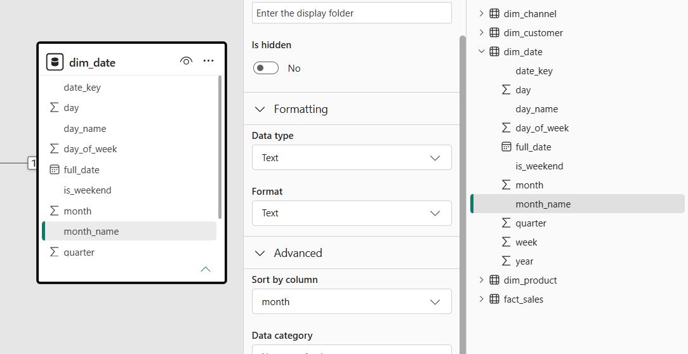
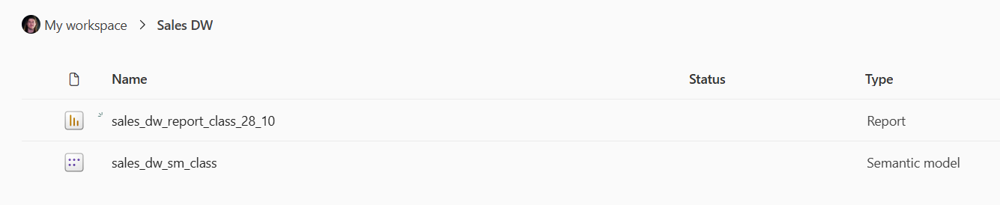
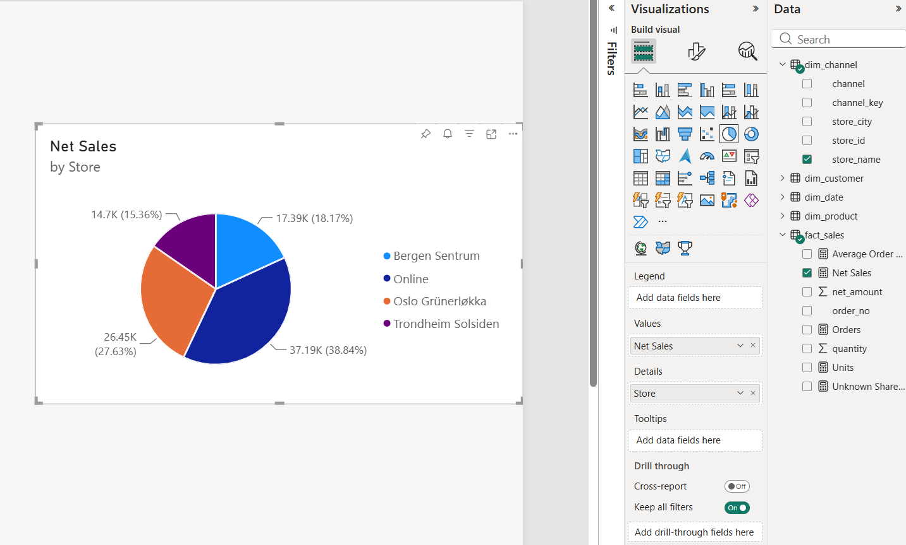

# Business Intelligence and Power BI

> In this lesson you will take apart published BI dashboards to find the measures, dimensions and OLAP operations behind each one. You will then copy the sales warehouse into Azure SQL Database, and build a Power BI semantic model on it in the browser: the star schema's relationships, measures written in DAX, and a report whose visuals and filters do the OLAP operations for you.
>
> New terms get a plain-English version in brackets.

**By the end of this lesson you should be able to:**

1. **Describe** how a BI tool turns the OLAP operations into filters and clicks.
2. **Identify** the measures and dimensions behind a published dashboard.
3. **Describe** how Microsoft Fabric brings the ETL, warehouse and BI tools onto one platform.
4. **Use** T-SQL to copy a data warehouse into Azure SQL Database.
5. **Construct** a Power BI semantic model from the tables of a star schema.
6. **Use** DAX to define measures in a semantic model.
7. **Use** Power BI visuals and filters to build a report from a semantic model.

## Contents

1. [From the cube to a BI tool](#1-from-the-cube-to-a-bi-tool)
   - [1.1 The cube and its operations](#11-the-cube-and-its-operations)
   - [1.2 BI tools](#12-bi-tools)
2. [Reading a dashboard as a cube](#2-reading-a-dashboard-as-a-cube)
3. [Power BI and Microsoft Fabric](#3-power-bi-and-microsoft-fabric)
   - [3.1 One tool per step](#31-one-tool-per-step)
   - [3.2 Microsoft Fabric](#32-microsoft-fabric)
   - [3.3 Power BI in the browser](#33-power-bi-in-the-browser)
4. [Moving the warehouse to Azure](#4-moving-the-warehouse-to-azure)
   - [4.1 Why it has to move](#41-why-it-has-to-move)
   - [4.2 Creating the database](#42-creating-the-database)
   - [4.3 Copying the warehouse](#43-copying-the-warehouse)
5. [The semantic model](#5-the-semantic-model)
   - [5.1 Getting the data](#51-getting-the-data)
   - [5.2 Rebuilding the star](#52-rebuilding-the-star)
   - [5.3 Measures](#53-measures)
6. [The report](#6-the-report)
   - [6.1 The measures and the Filters pane](#61-the-measures-and-the-filters-pane)
   - [6.2 Charts](#62-charts)
   - [6.3 The operations in a report](#63-the-operations-in-a-report)
7. [What you learned](#7-what-you-learned)
8. [Sources](#8-sources)

## 1. From the cube to a BI tool

### 1.1 The cube and its operations

Recall the chain a business's data travels along before anyone reads it. The source systems record each sale, ETL moves the data into the warehouse, data marts split it up for the people who use it, and OLAP cubes organise it around the questions people ask. At the end, BI tools turn the cube into the reports people actually read.

In Power BI, the cube is called a **semantic model** *[a model over the warehouse that gives the data friendly names, defines the calculations and holds the relationships, so users don't have to know the tables]*. This lesson builds one.


The cube for the sales warehouse holds net sales, broken down by product category, store and quarter. Every combination of one category, one store and one quarter is one cell, so there are 5 × 4 × 4 = 80 cells. The Bakery, Bergen Sentrum, Q1 cell holds 427.00.

Nobody reads all 80 cells at once. Each of the five OLAP operations picks out a view of the cube, and in SQL each one is a change to the query:

| Operation | What it does | In SQL |
|---|---|---|
| **Slice** | Fixes one dimension to a single value | `WHERE d.quarter = 1` |
| **Dice** | Keeps some of the values on several dimensions | `WHERE ch.store_name IN ('Online', 'Bergen Sentrum')`, and the same on other dimensions |
| **Drill-down** | Shows more detail, at a finer grain | A finer `GROUP BY`: from Q3 to its months, or from Snacks to its products |
| **Roll-up** | Shows less detail, at a coarser grain | A coarser `GROUP BY`, or a shorter one: from quarter to year, or with store left out |
| **Pivot** | Turns the result so a different dimension runs across the top | `PIVOT`, with every value listed by hand |

![Board titled Business Intelligence tools. In the middle, the sales cube with categories up the side, Bergen, Oslo, Trondheim and Online along the bottom and quarters going back, with 350, 200 and 400 in the bottom row. Around it: slice, filter by a single dimension, WHERE quarter = 1. Dice, filter by multiple dimensions, WHERE store_name IN Online and WHERE quarter IN 1, 2. Roll up, less detail, coarser grain, quarter to 2026, remove product category. Drill down, more detail, finer grain, a quarter to September, product category to coke and milk. Pivot, with a small cube turned so store, quarter and category sit on different axes](boards/03-olap-operations-recap.jpeg)

[Back to contents](#contents)

### 1.2 BI tools

Every one of the five operations was a query someone had to write. The people who need the answers, such as a store manager deciding what to stock, mostly don't write SQL.

A **BI tool** puts the cube in front of people who don't write SQL. The operations become clicking and dragging. Slice and dice become **filters**: you pick the quarter, or the stores and categories, from a list. Drill-down and roll-up become selecting a part of a chart to see what it's made of, or summarising it into a total.

Tableau and Microsoft's Power BI are two common BI tools. The dashboards in the next section were built in Tableau, and the report at the end of this lesson is built in Power BI.

[Back to contents](#contents)

## 2. Reading a dashboard as a cube

Tableau publishes a page of [Real-World Examples of Business Intelligence (BI) Dashboards](https://www.tableau.com/dashboard/business-intelligence-dashboard-examples). It says that each one "is interactive which gives you, the consumer of the dashboard, the opportunity to ask and answer your own questions". Asking your own question of a dashboard means slicing, dicing and drilling into it, without writing a query.

The page has six dashboards, and only some of them are about sales:

| Dashboard | What the page says it shows |
|---|---|
| **AAPL Ticker** | Apple's share price over the years. "By clicking on the dots, you can see how a product release or the end of quarter filing played a part." |
| **Super Sample Superstore** | A retailer's "sales, profit ratio, and shipping time", with a Prescriptive tab "to pinpoint the root cause" of a change |
| **Healthcare data** | Patient demographics and trends by department, using clustering to separate frequent short-stay patients from extended-stay patients |
| **Crimes in India** | A map of where crimes were committed from 2001 to 2014, by district and type of crime |
| **Global Market Overview** | Boeing's forecast of airplane demand over the next 20 years, over four tabs and ten chart types |
| **Race to Alaska** | The route and speed of the top five teams in a 750-mile boat race, with a heat map of their fastest hours |

Every one of them is a cube with a chart drawn on it. Reading a dashboard as a cube means finding the same parts you found in the sales question.

**The measures** are the numbers being worked out. For each one, ask how it's combined. Recall that `net_amount` is an **additive** measure *[one that can be summed across every dimension and still mean something]*, which is why `GROUP BY CUBE` could add the cells up into subtotals. Apple's share price isn't additive. Adding up a month of daily prices gives a number that means nothing, so rolling the price up to a month means taking an average, or the price at the close of the month. The Superstore's profit ratio has the same problem, because a ratio has to be worked out again from the totals underneath it.

**The dimensions** are what those numbers are broken down by. They show up as the axes, the legend, the colours, the filters and the areas on a map. Most dashboards have a time dimension, so look for how far down it goes: years, months, days or hours.

**A dimension's levels** are often visible as well. The crime map is drawn by district, and every district belongs to a state, which is the same shape as stores belonging to a channel in `dim_channel`.

With a measure and three dimensions you can write the cube down in words, the same way as the sales cube:

```text
Measure:     net sales
Dimension 1: product category  (Bakery, Beverages, Snacks, ...)
Dimension 2: store             (Bergen, Oslo, Online, ...)
Dimension 3: quarter           (Q1, Q2, Q3, Q4)
One cell:    Snacks, sold online, in Q3
```

**The operations** are whatever the dashboard lets you click. A filter on one field is a slice, and filters on several are a dice. Clicking a dot on the Apple chart to see the event behind it is a drill-down. So is the Superstore's Prescriptive tab, which the page says is there "to pinpoint the root cause": it goes from what changed to why. Not every dashboard supports all five, and the healthcare dashboard does something that isn't an operation at all. Its clustering finds groups of patients that nobody asked about, which is data mining rather than reading a cube.

**The decision** is the reason the dashboard exists. Someone looks at it, and does something differently because of it. A store manager might move stock between shops, and a hospital might plan beds around how long patients stay.

**The chart** suits the data it shows. Crimes by district go on a map because the dimension is a place. A price changing over time suits a line, because time runs continuously along one axis. A heat map, like the one of the Race to Alaska teams' fastest hours, is a grid of two dimensions with the measure shown as colour.

[class-activity.md](class-activity.md) takes you through these questions for two or three of the dashboards.

[Back to contents](#contents)

## 3. Power BI and Microsoft Fabric

### 3.1 One tool per step

Until recently, Microsoft sold a separate product for each step of the chain:

- **Azure Data Factory** for the ETL.
- **Azure Synapse Analytics** for the warehouse, with **Spark** *[a framework for processing very large datasets across many machines]* for big data.
- **Power BI** for the semantic model and the reports.

Each product was set up, billed and secured separately. Each one also kept its own copy of the data, so the same data was duplicated from one product to the next, and joining them together was the customer's job.

[Back to contents](#contents)

### 3.2 Microsoft Fabric

Microsoft put these tools on one platform and called it Fabric. Microsoft's overview, [What is Microsoft Fabric?](https://learn.microsoft.com/en-us/fabric/fundamentals/microsoft-fabric-overview), describes it like this:

> Microsoft Fabric is an analytics platform that supports end-to-end data workflows, including data ingestion, transformation, real-time stream processing, analytics, and reporting. It provides integrated experiences such as Data Engineering, Data Factory, Data Science, Real-Time Intelligence, Data Warehouse, and Databases, which operate over a shared compute and storage model.

Three things change:

- **One store.** Every tool reads and writes the same **data lake** *[one big store that holds an organisation's data as files and tables]*, called **OneLake**. There's one per organisation, and Microsoft says it enables "shared access to data across workloads without requiring data movement or duplication". Microsoft compares it to OneDrive: it's there by default, and everything uses it.
- **One bill.** One pool of compute, called a **capacity**, runs all of it, instead of one resource per product.
- **One place.** One website, and one set of permissions for all of it.

The chain now maps onto parts of one product. **Data Factory** does the ETL, **Data Warehouse** holds the warehouse, and **Power BI** holds the semantic model and the reports, all over OneLake.

Microsoft's [What is Power BI?](https://learn.microsoft.com/en-us/power-bi/fundamentals/power-bi-overview) puts it plainly: "Power BI is a core component of Microsoft Fabric." That's why the Power BI website is now the Fabric portal. When you create something there, the list of item types includes lakehouses and mirrored databases as well as reports and semantic models. A semantic model also used to be called a **dataset**, and older tutorials still use that name.

![Board titled Business Intelligence tools. In the middle: BI tools put the cube in front of people who don't write SQL, so operations become clicking and dragging, with slice and dice as filters and roll-up and drill down as selections and summaries, and Power BI = Fabric portal. On the right: ETL is Azure Data Factory, the warehouse is Azure Synapse Analytics with PySpark for big data, and BI is Power BI, each billed, stored and secured separately. These lead to Fabric, unified: one bill, one set of permissions, one place to store, and the OneLake catalog. On the left, our path: Azure SQL, then a semantic model with measures, then a report](boards/04-bi-tools-and-fabric.jpeg)

The rest of this lesson follows one path through it: the warehouse goes into Azure SQL, a semantic model with measures goes on top of it, and a report goes on top of that.

[Back to contents](#contents)

### 3.3 Power BI in the browser

Power BI comes in two main parts. **Power BI Desktop** is a Windows app, and the **Power BI service** is the website, at [app.powerbi.com](https://app.powerbi.com/). Microsoft's overview says that "Desktop is best for data modeling and report creation, while the service is ideal for sharing and collaboration".

The service can now build models too. According to [Edit semantic models in the Power BI service](https://learn.microsoft.com/en-us/power-bi/transform-model/service-edit-data-models), you can create and edit them in the browser "using actions such as Power Query editing, managing relationships, creating DAX measures, and defining row-level security roles".

Everything in this lesson happens in the service, in **My workspace**, your own personal workspace. Most tutorials, and most of the Moodle material, use Desktop, so the menus you see there won't always match the browser.

[Back to contents](#contents)

## 4. Moving the warehouse to Azure

### 4.1 Why it has to move

The Power BI service runs in Microsoft's cloud. The warehouse runs in a container on your laptop, at `localhost`, and nothing in Microsoft's cloud can reach `localhost` on your machine. Power BI Desktop could connect to it, because Desktop runs on the same machine, but Desktop only runs on Windows.

So the warehouse has to move somewhere the cloud can reach. Recall **Azure SQL Database**: it's SQL Server that Microsoft runs for you, behind a firewall that blocks everyone until you add a rule.

[Back to contents](#contents)

### 4.2 Creating the database

The database is created like any other Azure SQL database, from the Azure portal: **SQL databases**, then **Create**.

- Use the logical server you already have, or create a new one with SQL authentication.
- Name the database `sales-dw`, choose the **Development** workload, and set compute and storage to **Basic**.
- Set **Allow Azure services and resources to access this server** to **Yes**. This time the Azure service that needs in is Power BI, and without the rule it can't connect. Recall that the rule lets in all of Azure, not only your own resources, so the login and password are what keep everyone else out.
- Add your current client IP address, so VS Code on your laptop can connect.

Then connect to `sales-dw` from the mssql extension in VS Code with **Load from Connection String**, using the connection string from the database's **Connection strings** page.

[Back to contents](#contents)

### 4.3 Copying the warehouse

The warehouse is copied into `sales-dw` with two scripts, run one after the other in a query window connected to `sales-dw`.

**[sales_dw-tables.sql](sales_dw-tables.sql)** creates the five tables: the four dimensions, then `fact_sales`. Recall why the fact table comes last: its foreign keys refuse a row whose dimension row doesn't exist yet, so the dimensions have to be there first.

**[sales_dw-data.sql](sales_dw-data.sql)** fills them. It's the whole local warehouse written out as `INSERT` statements, one per row, in the same order. Here are the lines for `dim_channel`, and the first two sales:

```sql
SET IDENTITY_INSERT dim_channel ON;
INSERT INTO dim_channel (channel_key, channel, store_id, store_name, store_city) VALUES (1, N'Web', NULL, N'Online', NULL);
INSERT INTO dim_channel (channel_key, channel, store_id, store_name, store_city) VALUES (2, N'Till', 1, N'Bergen Sentrum', N'Bergen');
INSERT INTO dim_channel (channel_key, channel, store_id, store_name, store_city) VALUES (3, N'Till', 2, N'Oslo Grünerløkka', N'Oslo');
INSERT INTO dim_channel (channel_key, channel, store_id, store_name, store_city) VALUES (4, N'Till', 3, N'Trondheim Solsiden', N'Trondheim');
SET IDENTITY_INSERT dim_channel OFF;
...
INSERT INTO fact_sales VALUES (20251021, 4, 2, 4, 'T-0026', 1, 35.00);
INSERT INTO fact_sales VALUES (20251021, 4, 9, 4, 'T-0026', 1, 39.00);
```

The surrogate keys are `IDENTITY` columns, so normally SQL Server picks them. Here they have to stay exactly as they were, because every fact row points at them: the first sale above is product 2 and channel 4. `SET IDENTITY_INSERT ... ON` lets the script write the keys itself.

Then check the copy the same way you checked the warehouse load, now against `sales-dw`:

```sql
SELECT COUNT(*), SUM(net_amount) FROM fact_sales;
```

| | |
|---|---|
| 1455 | 95736.30 |

1 455 rows and 95 736.30 in net sales, the same as the local warehouse.

[Back to contents](#contents)

## 5. The semantic model

### 5.1 Getting the data

In My workspace, the steps to bring the warehouse into Power BI are:

1. **+ New item**, then **Semantic model**, then **Get data**, and choose **Azure SQL database**.
2. Enter the server, `<your-server>.database.windows.net`, and the database, `sales-dw`.
3. Choose the authentication kind **Basic**, and sign in with the server admin login and password you chose when you created the logical server. The [Azure SQL database connector](https://learn.microsoft.com/en-us/power-query/connectors/azure-sql-database) only asks for a gateway when one is needed, and here it isn't, because the database is already in the cloud.
4. Tick all five tables.
5. Select **Transform data**. This opens the **Power Query editor** *[Power BI's tool for cleaning and reshaping data on its way in]*. The warehouse is already clean, so there's nothing to change here, and Power Query has a lesson of its own later in the course.
6. Finish with **Create a semantic model only**, not **Create a report**.

The Edit semantic models page describes **Create a semantic model only** as "ideal if you want to refine your semantic model, add relationships, create DAX measures, or configure row-level security before building reports". The semantic model needs relationships before a report can use it, and they aren't there yet.

This makes an **import** semantic model: Power BI copies the rows into the model, the same way an OLAP cube keeps its own copy of the data. When the warehouse changes, the model has to be refreshed to see it.

[Back to contents](#contents)

### 5.2 Rebuilding the star

Open the model in **Editing mode** and look at the diagram. The five tables are there, but nothing connects them. The foreign keys on `fact_sales` were in Azure, and none of them came across.

So the import brought the rows and left the structure behind. Microsoft's docs say so directly: "When importing data using Power Query in the Power BI service, relationships defined in the underlying data sources aren't automatically imported. These relationships must be manually recreated in the semantic model."

> What Power BI needs instead is a **relationship** *[a link between a column in one table and a column in another, which tells a filter on one table which rows of the other it applies to]*.

A foreign key and a relationship use the same columns but do different jobs. The foreign key guards writes: SQL Server refuses a fact row whose key has no dimension row. The relationship steers reads: when a report filters `dim_product` to Snacks, the relationship is how Power BI knows which `fact_sales` rows that means.

To draw a relationship, drag the key column from `fact_sales` onto the same column in its dimension. There are four:

| From | To | Cardinality |
|---|---|---|
| `fact_sales[date_key]` | `dim_date[date_key]` | many to one |
| `fact_sales[customer_key]` | `dim_customer[customer_key]` | many to one |
| `fact_sales[product_key]` | `dim_product[product_key]` | many to one |
| `fact_sales[channel_key]` | `dim_channel[channel_key]` | many to one |

**Many to one** is the fact-to-dimension link in words: many sales, each with one product. Microsoft's guidance on [star schemas in Power BI](https://learn.microsoft.com/en-us/power-bi/guidance/star-schema) says the cardinality is what makes a table a dimension or a fact: "The 'one' side is always a dimension table while the 'many' side is always a fact table." The same article sums up the two jobs: "Dimension tables enable *filtering* and *grouping*. Fact tables enable *summarization*."

Then hide the key columns: the four on `fact_sales`, and the one on each dimension. Ctrl-click them all, and set **Is hidden** in the **Properties** pane. The relationships still work, but nobody building a report needs `channel_key` in a chart.


The icons next to the columns say how Power BI will treat them. A **∑** marks a number Power BI will add up if you drag it into a chart, and that includes `quarter` and `month` in `dim_date`, which are numbers but not measures. A calculator icon marks a measure, which is what the next part adds.

One more column needs a setting. `month_name` is text, so Power BI sorts it alphabetically, and a chart by month would start with April and August. Select `month_name`, and set **Sort by column** to `month` in the **Properties** pane. The names now sort by the month number behind them, which is the same reason the drill-down query from quarter to month grouped by `d.month` as well as `d.month_name`.



[Back to contents](#contents)

### 5.3 Measures

A **measure** in Power BI is a named calculation that Power BI works out for whichever part of the cube a visual is showing. Microsoft's [DAX overview](https://learn.microsoft.com/en-us/dax/dax-overview) describes measures as "dynamic calculation formulas where the results change depending on context".

Measures are written in **DAX** *[Data Analysis Expressions, Microsoft's formula language for Power BI, Analysis Services and Power Pivot in Excel]*. It looks like an Excel formula, but it works on whole columns and tables rather than single cells.

A measure doesn't have one value. It's worked out again for every cell a visual shows, using that cell's row, column, slicers and filters. The DAX overview says that "a separate query is run for each cell in the results", and calls what each cell sits under its **filter context**. That's the cube again: one formula, with a different answer in each cell.

To add a measure, select `fact_sales` in the **Data** pane and choose **New measure**, one measure at a time:

```dax
Net Sales = SUM ( fact_sales[net_amount] )

Units = SUM ( fact_sales[quantity] )

Orders = DISTINCTCOUNT ( fact_sales[order_no] )

Average Order Value = DIVIDE ( [Net Sales], [Orders] )
```

A measure is filed under the table that was selected when you made it, but that's only where it's listed. Its formula can use any table in the model.

**`Orders` counts distinct order numbers.** Recall that `order_no` is a degenerate dimension, kept on the fact table even though it has no table of its own. One order has a row for each product on it, so counting rows would count order lines. Counting the distinct order numbers is the only way to count orders, and it's why `order_no` was kept.

**`Average Order Value` divides one measure by another.** `DIVIDE` works like `/`, except that it returns a blank instead of an error when the bottom is zero. Notice that it uses `[Net Sales]` and `[Orders]`, not the columns, so it's built from the measures above it.

One more measure works out a number from the end of the warehouse build: how much of the till sales came from customers without a loyalty card.

```dax
Unknown Share of Till Sales =
DIVIDE (
    CALCULATE ( [Net Sales], dim_customer[city] = "Unknown" ),
    CALCULATE ( [Net Sales], dim_channel[channel] = "Till" )
)
```

`CALCULATE` works a measure out under an extra filter. The top line is Net Sales for the Unknown customer only, and the bottom line is Net Sales for the till channel only. Unknown customers only buy at the tills, so the top is 19 640.00 and the bottom is 58 549.00. Formatted as a percentage, the measure shows 33.5%.

A measure has no value in the model view, because there's no cell for it to fill. You see what it returns once it's in a visual.

[Back to contents](#contents)

## 6. The report

From the model editor, **New report** opens a blank report built on the semantic model. When you save it, it appears in the workspace as an item of its own, next to the model:



The model holds the data, the relationships and the measures. The report only holds the visuals, so several reports can share one model.

A report page has three panes down the right. **Data** lists the tables, columns and measures from the model. **Visualizations** has the chart types and the **wells** *[the slots, such as X-axis, Y-axis, Legend and Values, that you drag fields into]* for the selected visual. **Filters** holds the filters.

[Back to contents](#contents)

### 6.1 The measures and the Filters pane

The first visual is a check that the measures are right. A **Table** visual with `channel` and the four measures gives one row per channel, and a Total row:

![A table visual with columns channel, Net Sales, Orders, Units and Average Order Value. Till 58,549.00, 360, 1464, 162.64. Web 37,187.30, 240, 925, 154.95. Total 95,736.30, 600, 2389, 159.56. The Filters pane beside it has a card for each field in the table: channel is (All), with filter type Basic filtering and tick boxes for Till, with 3 beside it, and Web, with 1. Net Sales is (All), with Show items when the value is less than, a value box and Apply filter. Orders is (All) below it. The Data pane has channel and the four measures ticked](screenshots/04-measures-table.png)

The totals match the warehouse: 95 736.30 in net sales, from 600 orders.

Look at Average Order Value. The two channels average 162.64 and 154.95, and the total is 159.56. That isn't their sum, and it isn't their average either, which would be 158.80.

So Power BI didn't combine the two rows above it. It worked the measure out again for the Total row, from that row's own Net Sales and Orders: 95 736.30 divided by 600. A ratio has to be worked out this way in every cell, because it isn't additive. That's what a measure does that a summed column can't.

The **Filters** pane is open beside the table, and it already has a filter card for every field in the visual. Nobody added them: putting a field into a visual gives it a card under **Filters on this visual**, set to "(All)" until you change it.

The `channel` card uses **Basic filtering**, a list of the column's values with a tick box each. The number beside each value is how many rows of `dim_channel` have it: three till stores and one web shop. Ticking only Till leaves one row in the table, which is a slice. Ticking values on the cards for several fields at once is a dice.

The Net Sales card works differently, because a measure has no fixed list of values to tick. Instead it asks for a condition, such as "Show items when the value is less than" a number you type, and hides the rows whose Net Sales doesn't meet it. In SQL that's a `HAVING` rather than a `WHERE`, because it filters on the result of the `SUM`.

**Filter type** at the top of a card changes how it filters. Basic filtering and the value condition are two kinds, and **Top N** is another, which the best-selling products chart uses.

A card under **Filters on this visual** only changes this table. Lower down the pane, **Filters on this page** reaches every visual on the page, and **Filters on all pages** reaches the whole report.

[Back to contents](#contents)

### 6.2 Charts

Each chart is a `GROUP BY` that you build by dragging fields into wells. The questions are the same ones the warehouse answered in SQL, so each chart can be checked against the SQL result.

**Which shop sells the most?** A pie chart with Net Sales in **Values** and `store_name` in **Details**:



The slices match the SQL answer: Online 37 187.30, then Oslo Grünerløkka 26 454.00. A field in a well can be renamed for that visual only, which is why `store_name` shows as "Store" here.

**What are the best-selling products?** A bar chart with `name` on the **Y-axis** and Net Sales on the **X-axis**. The SQL used `TOP 5`, and in Power BI the same thing is a filter: the product card under **Filters on this visual** is switched to the **Top N** filter type, showing the top 5 by Net Sales:


Laundry detergent is first, at 15 005.40, as it was in SQL.

[Back to contents](#contents)

### 6.3 The operations in a report

The charts needed no SQL, but each one still did an OLAP operation.

**Slice and dice are filters.** Ticking only 1 on a `quarter` card is a slice, and narrowing the category, store and quarter cards together is a dice. Put the cards under **Filters on this page**, and every chart on the page is sliced the same way.

**Selecting a part of a chart filters the others.** Microsoft's [visual interactions](https://learn.microsoft.com/en-us/power-bi/create-reports/service-reports-visual-interactions) page says that "by default, visualizations on a report page cross-filter and cross-highlight the other visualizations on the page".

To see it, put a second chart next to the pie: a stacked bar chart with `name` on the Y-axis, Units on the X-axis, and `quarter` in the **Legend**. The legend is a second dimension, not just a colour key: it splits every bar by the field in it, so product on the axis and quarter in the legend is `GROUP BY p.name, d.quarter`. A stacked chart piles the pieces into one bar, so the bar shows the product's total as well. A clustered chart would put them side by side.

Select the Q3 piece of the Laundry detergent bar, and the pie chart highlights just that piece of each store:


One click fixed the product and the quarter, and the pie shows that cell of the cube spread across the stores. In SQL that's a `WHERE` on two dimensions and a `GROUP BY store_name`.

**Drill-down and roll-up change the fields in a visual.** Adding a field, such as `quarter` in the legend, splits each bar into finer pieces, which is a drill-down. Taking a field out adds its pieces back together, which is a roll-up. The Total row in the measures table is a roll-up too, all the way to everything: it's the same row as `NULL, NULL, NULL` from `GROUP BY CUBE`.

> The semantic model is the cube, the measures are what each cell holds, and the visuals and filters are the operations.

[Back to contents](#contents)

## 7. What you learned

You've now taken the warehouse from a container on your laptop to a report anyone can click through.

**A dashboard is a cube with a chart drawn on it.** Whether it's sales, share prices or a boat race, there's something being worked out and something it's broken down by. Once you can find the measures and the dimensions, you can read any dashboard, and say which operations it lets you do.

**Not every number adds up.** Net sales does, which is why the cube's subtotals worked. A share price, a profit ratio or an average order value doesn't, and has to be worked out again from the totals underneath it.

**Microsoft's data tools now live on one platform.** The ETL, the warehouse and the reports used to be separate products, each with its own bill and its own copy of the data. Fabric puts them over one store, OneLake, and Power BI is one part of it.

**The cloud can't see your laptop.** Power BI in the browser could only reach the warehouse once it was in Azure SQL. Copying it meant the tables first and the rows second, with `IDENTITY_INSERT` keeping every surrogate key the fact rows point at.

**Importing the data doesn't import the design.** The rows arrived, but the star didn't. The four many-to-one relationships had to be drawn again by hand, because they're what tell a filter on a dimension which sales it applies to.

**A measure is worked out again in every cell.** That's why Average Order Value is right in the Total row, where adding or averaging the rows above would get it wrong. In the report, filters slice and dice, a click on one chart filters the rest, and adding or removing a field drills down or rolls up.

[Back to contents](#contents)

## 8. Sources

1. Tableau, [Real-World Examples of Business Intelligence (BI) Dashboards](https://www.tableau.com/dashboard/business-intelligence-dashboard-examples)
2. Microsoft Learn, [What is Microsoft Fabric?](https://learn.microsoft.com/en-us/fabric/fundamentals/microsoft-fabric-overview)
3. Microsoft Learn, [What is Power BI?](https://learn.microsoft.com/en-us/power-bi/fundamentals/power-bi-overview)
4. Microsoft Learn, [Edit semantic models in the Power BI service](https://learn.microsoft.com/en-us/power-bi/transform-model/service-edit-data-models)
5. Microsoft Learn, [Power Query Azure SQL database connector](https://learn.microsoft.com/en-us/power-query/connectors/azure-sql-database)
6. Microsoft Learn, [Understand star schema and the importance for Power BI](https://learn.microsoft.com/en-us/power-bi/guidance/star-schema)
7. Microsoft Learn, [DAX overview](https://learn.microsoft.com/en-us/dax/dax-overview)
8. Microsoft Learn, [Change how visuals interact in a report](https://learn.microsoft.com/en-us/power-bi/create-reports/service-reports-visual-interactions)

[Back to contents](#contents)
